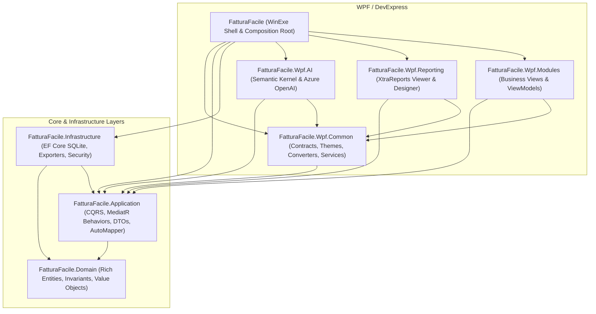
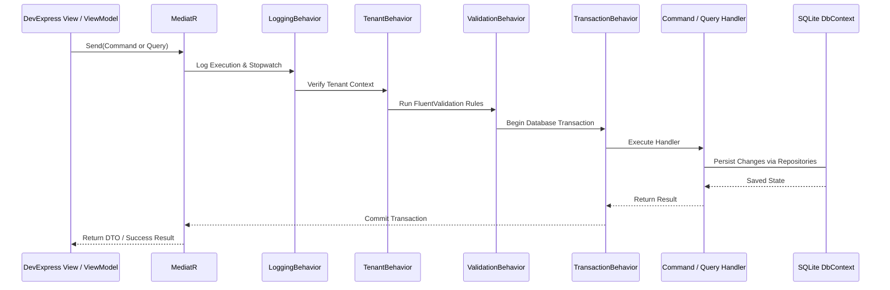

# FatturaFacile - System Architecture & Technical Specifications

This document outlines the architectural patterns, runtime mechanisms, and design decisions governing **FatturaFacile**.

---

## 1. Clean Architecture & Modular Presentation Principles

The solution enforces a strict inward dependency rule across its 8 source projects:



### Layer Responsibilities

1. **`FatturaFacile.Domain` (Core Domain)**
   - Contains all domain logic, rich entities with private setters, business invariants, domain events, value objects, and repository interfaces.
   - **Zero external dependencies**: Depends only on the .NET runtime (`System.*`). No references to EF Core, MediatR, or WPF libraries.

2. **`FatturaFacile.Application` (Business Orchestration)**
   - Organizes application use cases using the **CQRS (Command Query Responsibility Segregation)** pattern with **MediatR**.
   - Contains DTOs, concrete AutoMapper profiles, FluentValidation validators, application interfaces, and pipeline behaviors.
   - Depends solely on `FatturaFacile.Domain`.

3. **`FatturaFacile.Infrastructure` (Data Access & Exporters)**
   - Implements interfaces defined in the Domain and Application layers.
   - Contains EF Core SQLite configuration (`FatturaFacileDbContext`), repository implementations, PBKDF2 password hasher, dynamic SQLite localization store, and export engines (FatturaPA XML, Swiss QR-Bill SVG, ISO 20022 `pain.001`, `camt.053`).
   - Depends on `FatturaFacile.Application` and `FatturaFacile.Domain`.

4. **Modular Presentation Layer (WPF & DevExpress)**
   - **`FatturaFacile.Wpf.Common`**: Shared UI infrastructure providing core contracts (`IDocumentModule`, `INavigationItem`, `IModuleInitializer`), services (`IUserStateService`, `IViewModelFactory`, `LocalizationManager`), custom markup extensions (`TranslateExtension`), converters, behaviors, and DevExpress lightweight themes.
   - **`FatturaFacile.Wpf.Modules`**: Core business views and viewmodels (Dashboard, Clients/CRM, Invoices/Sales, Tire Hotel, Time Tracking, and Localization Admin).
   - **`FatturaFacile.Wpf.Reporting`**: DevExpress XtraReports engine integration: report viewer, report designer, print preview controls, mail merge templates, and cross-border document rendering.
   - **`FatturaFacile.Wpf.AI`**: AI integration module leveraging Microsoft.Extensions.AI, Semantic Kernel, and Azure OpenAI for DevExpress Chat, smart paste, prompt-to-expression, and document assistants.
   - **`FatturaFacile` (Entry Point / WinExe)**: Composition root and host shell. Configures generic host (`AppHost`), JIT profile optimization, dependency injection scanning, DevExpress `ThemedWindow` with `DockLayoutManager`, and docking layout serialization (`DXSerializer`).

> **Architectural Constraint**: Feature presentation modules (`Wpf.Modules`, `Wpf.Reporting`, `Wpf.AI`) **never** reference `FatturaFacile.Infrastructure`. They communicate exclusively through `FatturaFacile.Application` and `FatturaFacile.Wpf.Common`.

---

## 2. Dynamic Module Registration & ViewModel Resolution

### Module Registration via `IModuleInitializer`
Each UI assembly declares an implementation of `IModuleInitializer`:
```csharp
public interface IModuleInitializer
{
    void Initialize(IServiceCollection services, IConfiguration configuration);
}
```
During startup, `PresentationServiceCollectionExtensions.AddPresentationServices()` scans presentation assemblies and invokes each initializer, registering Views and ViewModels without coupling the shell to internal module implementation details.

### On-Demand ViewModel Resolution via `IViewModelFactory`
ViewModels are registered as `Transient` and resolved on demand via `IViewModelFactory`. This guarantees:
- Fast application startup without instantiating heavy view model graphs eagerly.
- Clear disposal and garbage collection when document tabs are closed.
- Decoupled navigation where navigation items only need to know the target ViewModel type.

---

## 3. DevExpress Docking Layout & State Persistence

### Windows Store (MSIX) Compatibility
Under MSIX packaging, the application installation folder (`C:\Program Files\WindowsApps\...`) is strictly read-only. FatturaFacile stores all mutable runtime state in `%LocalAppData%\FatturaFacile\`:
- Database: `%LocalAppData%\FatturaFacile\FatturaFacile.db`
- Layout & User State: `%LocalAppData%\FatturaFacile\userstate.json`

### Layout Serialization (`DXSerializer`)
- The main workspace layout utilizes DevExpress `DockLayoutManager` with a central `DocumentGroup`.
- Layout state is serialized via `DevExpress.Xpf.Core.Serialization.DXSerializer` with declared `SerializationID` and `LayoutVersion`.
- Layout upgrades handle version differences smoothly using `RestoreLayoutOptions.RemoveOldPanels="True"` and `RestoreLayoutOptions.AddNewPanels="True"`.
- `IUserStateService` coordinates saving and resetting layout state, backing up existing configurations before applying schema updates.

---

## 4. CQRS & MediatR Pipeline Architecture

Every user action or background query flows through MediatR pipeline behaviors registered in strict sequence:



### Pipeline Behaviors:
- **`LoggingBehavior<TRequest, TResponse>`**: Measures execution time, logs structured warnings for slow requests (>500ms).
- **`TenantBehavior<TRequest, TResponse>`**: Validates that a tenant is currently selected before processing tenant-scoped commands.
- **`ValidationBehavior<TRequest, TResponse>`**: Executes all FluentValidation validators registered for the request; fails fast by throwing a `ValidationException` containing structured errors.
- **`TransactionBehavior<TRequest, TResponse>`**: Wraps modifying commands inside a database transaction, guaranteeing atomic rollbacks on failure.

---

## 5. Multi-Tenancy & Data Isolation

FatturaFacile supports complete multi-tenant isolation within a shared SQLite database:

1. **`ITenantEntity` Interface**:
   ```csharp
   public interface ITenantEntity
   {
       Guid TenantId { get; set; }
   }
   ```
2. **EF Core Global Query Filters**:
   In `FatturaFacileDbContext.OnModelCreating()`, all entities implementing `ITenantEntity` automatically receive a query filter:
   ```csharp
   modelBuilder.Entity<Client>().HasQueryFilter(e => e.TenantId == CurrentTenantId);
   ```
3. **Dynamic Tenant Switching**:
   When the user switches tenants using the header dropdown, `ITenantProvider.SetCurrentTenant(newTenantId)` updates the current context and signals the UI to refresh without requiring an application restart.

---

## 6. Value Objects & Cross-Border Invariants

Cross-border operations between Italy and Switzerland require strict domain validation:

| Value Object | Validations & Business Rules |
| :--- | :--- |
| **`Money`** | Immutable `(decimal Amount, Currency Currency)`. Multi-currency operations between EUR and CHF are blocked. Features statutory Swiss cash rounding to the nearest 0.05 (`ToSwissCashRounding()`). |
| **`FiscalCode`** | Validates Italian 16-character alphanumeric Codice Fiscale or 11-digit temporary/numeric codes via regex. |
| **`VatNumber`** | Validates Italian 11-digit Partita IVA (`ITxxxxxxxxxxx`) and Swiss Business Identification Numbers (`CHE-xxx.xxx.xxx MWST/TVA/IVA`). |
| **`QrIban`** | Validates Swiss/Liechtenstein QR-IBANs (21 characters starting with `CH` or `LI`) with Institute Identification (IID) falling strictly in the range **30000 to 31999**. |
| **`Address`** | Encapsulates street, postal code, city, province/canton, and ISO country code (`IT`, `CH`). |

---

## 7. Dynamic SQLite Localization (i18n)

Unlike traditional static `.resx` files, FatturaFacile stores translations in SQLite, allowing users and administrators to customize translations at runtime:

1. **Storage Schema**:
   `AppTranslations (Id, TenantId, Locale, Key, DefaultValue, CustomValue, UpdatedAt)`
2. **In-Memory Cache**:
   `SqliteLocalizationService` holds an in-memory `ConcurrentDictionary<(string Locale, string Key), string>` loaded on startup for zero-overhead string resolution.
3. **XAML Markup Extension**:
   `{loc:Translate KeyName, Default='Default Text'}` subscribes to `LocalizationManager.LanguageChanged` events to update UI bindings instantly.
4. **Admin UI**:
   Administrators can search, edit, and persist translations via the Localization Management view.

---

## 8. Security & Session Management

- **Password Storage**: Uses `PBKDF2` with HMAC-SHA512, 100,000 iterations, and a cryptographically secure 16-byte salt.
- **Session Timeout**: The application monitors user activity and triggers a secure session lock upon 15 minutes of inactivity, requiring re-authentication.
- **RBAC (Role-Based Access Control)**: Restricts access to sensitive views (such as general ledger entries, payroll records, and system administration) based on `UserRole`.
