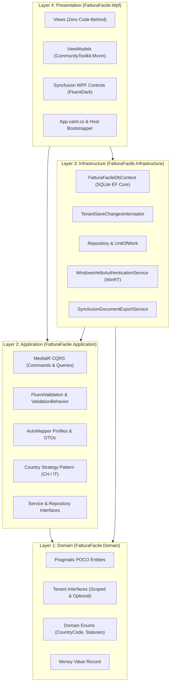
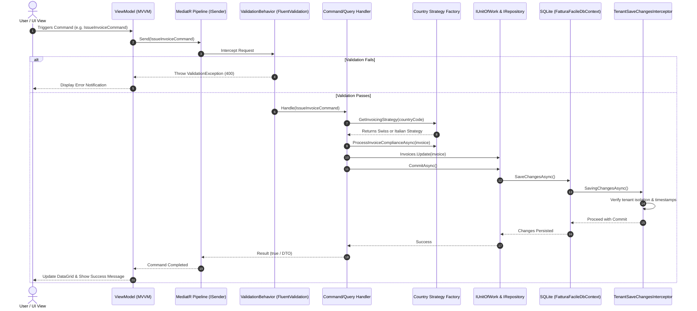

# Architecture Specification & Architectural Decision Records (ADR)
## FatturaFacile ERP Enterprise (.NET 11)

---

## 📑 Executive Summary

**FatturaFacile** is an enterprise desktop ERP, invoicing, and accounting solution architected for high reliability, offline-first performance, and rapid developer velocity. It targets the regulatory environments of **Switzerland (CH)** and **Italy (IT)**.

The solution is founded upon three core engineering pillars:
1. **Strict Clean Architecture:** Unidirectional dependency flow (`Domain <- Application <- Infrastructure / Wpf`) separating domain primitives, application orchestration, persistence, and presentation.
2. **ZERO Tactical DDD Mandate:** Intentional rejection of tactical Domain-Driven Design (AggregateRoots, Domain Events, Outbox Pattern, reflection ValueObjects) in favor of **Clean POCOs** and **CQRS Handlers**, maximizing junior developer velocity and eliminating object-relational impedance mismatch.
3. **Robust Isolation & Localization:** Row-level multi-tenancy with read-only shared defaults, localized Country Strategy patterns (CH vs IT), Syncfusion WPF presentation, and native biometric security via **Windows Hello**.

---

## 🏛️ 1. The 4 Clean Architecture Layers



### Layer Responsibilities & Boundaries

| Layer | Project Name | Responsibilities | Forbidden Patterns |
| :--- | :--- | :--- | :--- |
| **1. Domain** | `FatturaFacile.Domain` | Enterprise core definitions: Entities (`Invoice`, `Contact`, `Product`), Interfaces (`ITenantScopedEntity`, `IOptionalTenantEntity`), Enums (`CountryCode`, `InvoiceStatus`), and Records (`Money`). | **NO** external NuGet packages, **NO** EF Core annotations, **NO** domain event dispatchers, **NO** aggregate roots. |
| **2. Application** | `FatturaFacile.Application` | Business orchestration: CQRS Commands and Queries via **MediatR**, validation pipelines via **FluentValidation**, DTO mappings via **AutoMapper**, country-specific strategies, and port contracts (`IRepository<T>`, `IUnitOfWork`, `IDocumentExportService`). | **NO** direct database queries (SQL/EF Core), **NO** UI framework references (WPF/XAML). |
| **3. Infrastructure** | `FatturaFacile.Infrastructure` | Secondary adapters: SQLite persistence with EF Core, `TenantSaveChangesInterceptor`, hardware biometric authentication (`UserConsentVerifier`), document generation (PDF/Excel via Syncfusion). | **NO** direct exposure of DbContext to Presentation layer. Must strictly implement Application interfaces. |
| **4. Presentation** | `FatturaFacile.Wpf` | Primary adapter: Desktop UI built with pure MVVM, CommunityToolkit source generators, Syncfusion dark-themed controls, and application startup authentication. | **NO** business calculation logic, **NO** code-behind event handlers in `*.xaml.cs`. |

---

## 🚫 2. Architectural Decision: The ZERO DDD Mandate

### Decision Context
In enterprise .NET development, tactical Domain-Driven Design (DDD) often introduces:
- Complex `AggregateRoot<TId>` base classes.
- Internal domain event collections (`List<IDomainEvent>`) requiring event dispatchers.
- Transactional Outbox patterns requiring dedicated `outbox_messages` background worker polling.
- Reflection-heavy `ValueObject` base classes with private constructors, causing serialization friction.
- Massive cognitive friction and onboarding delays for junior and mid-level developers.

### Decision Outcome
**Tactical Domain-Driven Design is strictly PROHIBITED in FatturaFacile.**

Instead, the system enforces a **Pragmatic Clean POCO Architecture**:
1. **Entities are Pure POCOs:** Entities contain public parameterless constructors and direct property accessors (`{ get; set; }`). They represent data state cleanly without encapsulating transactional boundaries.
2. **C# Records for Composite Primitives:** Immutable composite attributes use clean C# records (e.g., `public sealed record Money(decimal Amount, string Currency)`).
3. **Application Layer Coordinates Business Rules:** Invoicing calculations, validations, state transitions, and audit logic belong in **MediatR Handlers** and **Country Strategies**, where dependencies are easily injected and tested.
4. **Direct Serialization & Mapping:** Clean POCOs serialize directly to JSON, map directly with AutoMapper without reflection hacks, and bind smoothly to WPF DataGrids.

### Comparison Matrix

| Architectural Feature | Tactical DDD (Banned) | FatturaFacile Pragmatic Clean POCO (Enforced) |
| :--- | :--- | :--- |
| **Entity Definition** | Inherits `AggregateRoot<TId>`, private setters, factory methods. | Plain C# class, public `{ get; set; }`, parameterless constructor. |
| **State Mutations** | Mutated only through domain entity methods (e.g., `invoice.AddLineItem(...)`). | Orchestrated through MediatR Command Handlers and Repositories. |
| **Side Effects** | Domain events emitted and serialized into Outbox tables. | Explicit service calls within the CQRS Command pipeline. |
| **Composite Values** | Complex abstract `ValueObject` with reflection-based equality. | Lightweight C# positional `record` (e.g., `Money`). |
| **Junior Onboarding** | Steep learning curve, frequent mistakes with encapsulation & tracking. | Instant ramp-up; intuitive, standard C# conventions. |
| **Object-Relational Mapping** | Complex EF Core value conversions and private backing field mappings. | Direct, high-speed EF Core property mappings. |

---

## 🔄 3. The CQRS Request Pipeline

All state modifications and queries flow through a standardized **MediatR pipeline** guaranteeing validation, consistency, and observability before reaching the persistence layer:



---

## 🏢 4. Multi-Tenancy & Shared Defaults Architecture

FatturaFacile implements a **hybrid multi-tenant model** supporting private tenant isolation alongside shared, read-only system defaults:

### 1. Dual-Tier Entity Classification
- **`ITenantScopedEntity`:** For tenant-private business records.
  - Non-nullable `Guid TenantId { get; set; }`.
  - Applied to: `Invoice`, `InvoiceItem`, `InvoiceQrBillData`, `InvoiceSdiMetadata`, `GeneralLedgerEntry`, `GeneralLedgerLine`, `HrEmployee`, `StockItem`.
  - EF Core Global Query Filter:
    ```csharp
    builder.HasQueryFilter(e => e.TenantId == _currentTenantService.TenantId);
    ```
- **`IOptionalTenantEntity`:** For reference data and shared templates.
  - Nullable `Guid? TenantId { get; set; }`.
  - When `TenantId == null`, the record is a **global shared default** created during database seeding.
  - Applied to: `Contact`, `Product`, `VatCode`, `ChartOfAccount`, `PaymentMethod`, `Warehouse`.
  - EF Core Global Query Filter:
    ```csharp
    builder.HasQueryFilter(e => e.TenantId == null || e.TenantId == _currentTenantService.TenantId);
    ```

### 2. TenantSaveChangesInterceptor Defense-in-Depth
The `TenantSaveChangesInterceptor` guarantees multi-tenant security at runtime:
1. **Immutability of Global Records:**
   ```csharp
   if (entry.Entity is IOptionalTenantEntity { TenantId: null } && 
       (entry.State == EntityState.Modified || entry.State == EntityState.Deleted))
   {
       throw new InvalidOperationException(
           $"Cannot modify or delete global/shared system default record of type '{entry.Entity.GetType().Name}'. Global records are strictly read-only.");
   }
   ```
2. **Automatic Tenant Assignment:**
   Newly added `ITenantScopedEntity` records with an empty `TenantId` automatically receive the active `TenantId` from `ICurrentTenantService`.
3. **Audit Stamping:**
   Entities implementing `IBaseEntity` automatically capture `CreatedAt` and `UpdatedAt` timestamps in UTC.

---

## 🌐 5. Country-Specific Strategy Pattern (CH & IT)

Fiscal compliance requirements diverge significantly between Switzerland and Italy. Rather than polluting domain models with conditional flags (`if (isSwiss) ... else if (isItalian) ...`), FatturaFacile uses the **Strategy Pattern**:

```text
FatturaFacile.Application/Strategies/
├── ICountryStrategyFactory.cs
├── CountryStrategyFactory.cs
├── ICountryInvoicingStrategy.cs
├── ICountryTaxAndRoundingStrategy.cs
├── ICountryPayrollStrategy.cs
├── Swiss/
│   ├── SwissInvoicingStrategy.cs
│   ├── SwissTaxAndRoundingStrategy.cs
│   └── SwissPayrollStrategy.cs
└── Italian/
    ├── ItalianInvoicingStrategy.cs
    ├── ItalianTaxAndRoundingStrategy.cs
    └── ItalianPayrollStrategy.cs
```

### Detailed Strategy Breakdown

#### 🇨🇭 Switzerland (`CountryCode.CH`)
- **Rounding Strategy (`SwissTaxAndRoundingStrategy`):**
  - Currency: `CHF`.
  - Implements the Swiss **5-centimes (0.05 Rappen) rounding rule**:
    $$\text{Rounded} = \frac{\text{Round}(\text{Amount} \times 20)}{20}$$
  - The exact difference between mathematical net total and cash rounding is recorded in `Invoice.RoundingAmount`.
- **Invoicing Strategy (`SwissInvoicingStrategy`):**
  - Complies with Swiss Payment Standards (ISO 20022).
  - Populates `InvoiceQrBillData` with Swiss QR-IBAN (`CH...`), debtor address, amount in CHF/EUR, and a 27-digit Structured Creditor Reference (**SCOR**).
- **Payroll Strategy (`SwissPayrollStrategy`):**
  - Complies with **Swissdec ELM** guidelines:
    - AHV / AVS (Old Age and Survivors): 5.3% employee deduction.
    - ALV / AC (Unemployment Insurance): 1.1% deduction.
    - BVG / LPP (Occupational Pension): Age-bracketed pension contributions.
    - UVG / LAA & KTG / AAN: Non-occupational accident and sickness daily allowance.
    - Quellensteuer: Withholding tax for foreign cross-border commuters.

#### 🇮🇹 Italy (`CountryCode.IT`)
- **Rounding Strategy (`ItalianTaxAndRoundingStrategy`):**
  - Currency: `EUR`.
  - Standard cent rounding using `Math.Round(amount, 2, MidpointRounding.AwayFromZero)`.
- **Invoicing Strategy (`ItalianInvoicingStrategy`):**
  - Complies with Italian Tax Agency (**Agenzia delle Entrate**) electronic invoicing via **SDI (Sistema di Interscambio)** using FatturaPA v1.2 XML specifications.
  - Populates `InvoiceSdiMetadata`:
    - `CodiceDestinatario`: 7-character SDI routing code or `"0000000"`.
    - `PecDestinatario`: Certified electronic mail address.
    - Split Payment (*Scissione dei pagamenti*) flag for public administrations.
    - Reverse Charge (*Inversione contabile*) flag.
    - Withholding Tax (*Ritenuta d'acconto*) deductions.
    - Virtual Stamp Duty (*Bollo virtuale*) for exempt invoices $> \text{€}77.47$.
- **Payroll Strategy (`ItalianPayrollStrategy`):**
  - INPS worker social security contribution (standard 9.19%).
  - IRPEF progressive income tax calculations with regional and municipal surcharges.
  - TFR (*Trattamento di Fine Rapporto*) severance pay accrual.
  - CCNL (*Contratto Collettivo Nazionale di Lavoro*) classification standards.

---

## 💾 6. Offline-First SQLite Persistence

FatturaFacile runs completely offline without requiring an external database server:
- **Database Engine:** SQLite accessed via `Microsoft.EntityFrameworkCore.Sqlite`.
- **File Location:** Local application data directory (`fattura-facile.sqlite`).
- **Concurrency & Safety:**
  - WAL mode (Write-Ahead Logging) enabled for simultaneous reading and writing.
  - Foreign keys strictly enabled.
- **Repository Pattern & Unit of Work:**
  - Generic repository `IRepository<T>` provides clean queryable access with specification filters and soft-deletion awareness.
  - `IUnitOfWork` orchestrates cross-repository transactions via `CommitAsync()`.

---

## 🖥️ 7. Presentation & Hardware-Backed Security

### Pure MVVM Architecture
- **CommunityToolkit.Mvvm:** ViewModels implement `ObservableObject`. Properties utilize `[ObservableProperty]` and commands utilize `[RelayCommand]` source generators.
- **Zero Code-Behind:** WPF code-behind files (`*.xaml.cs`) contain only:
  ```csharp
  public InvoicingView()
  {
      InitializeComponent();
  }
  ```
  All user interactions, data binding, and navigation flow through XAML bindings to ViewModel commands.

### Syncfusion WPF Enterprise Suite
- **FluentDark Theme:** Uniformly applied to all views via `Syncfusion.SfSkinManager.VisualStyle="FluentDark"`.
- **ChromelessWindow:** Frameless, modern title bar supporting dark mode and tenant switcher controls.
- **SfDataGrid:** High-speed virtualized grids with integrated sorting, filtering, column reordering, and cell templates.
- **Document Generation:** Native PDF and Excel generation via `SyncfusionDocumentExportService` using `Syncfusion.Pdf.Wpf` and `Syncfusion.XlsIO.Wpf`.

### Biometric Gate (Windows Hello / Passkeys)
- Hardware-backed biometric authentication enforced at application entry in `App.xaml.cs`:
  ```csharp
  var authService = _host.Services.GetRequiredService<IUserAuthenticationService>();
  var isAuthenticated = await authService.AuthenticateCurrentUserAsync(
      "Verifica identità biometrica per accedere a FatturaFacile ERP Enterprise.");
  ```
- Uses WinRT `Windows.Security.Credentials.UI.UserConsentVerifier`.
- Denied or cancelled authentication immediately triggers `App.Current.Shutdown(1)`, preventing unauthorized data access.
- Non-biometric workstations or automated testing environments fall back gracefully to allow development continuity.

---

## 📜 8. Architectural Decision History (ADR Log)

| ADR # | Date | Title | Status | Summary |
| :---: | :---: | :--- | :---: | :--- |
| **001** | 2026-01 | **Adopt Strict Clean Architecture** | **Accepted** | Divided solution into Domain, Application, Infrastructure, and Wpf layers with unidirectional inward references. |
| **002** | 2026-02 | **Enforce ZERO Tactical DDD Mandate** | **Accepted** | Banned AggregateRoots, Domain Events, and Outbox Pattern. Replaced with Pragmatic Clean POCOs and CQRS handlers to accelerate onboarding. |
| **003** | 2026-03 | **Row-Level Multi-Tenancy with Shared Defaults** | **Accepted** | Implemented `ITenantScopedEntity` and `IOptionalTenantEntity` with EF Core query filters and read-only interceptor protection. |
| **004** | 2026-04 | **Country Strategy Pattern for CH and IT** | **Accepted** | Encapsulated Swiss (CHF, 0.05 rounding, QR-Bill, Swissdec) and Italian (EUR, 0.01 rounding, SDI XML, INPS) logic behind `ICountryStrategyFactory`. |
| **005** | 2026-05 | **Syncfusion WPF with Pure MVVM** | **Accepted** | Selected Syncfusion WPF with FluentDark skin and zero code-behind MVVM powered by CommunityToolkit.Mvvm. |
| **006** | 2026-06 | **Biometric Gate with Windows Hello** | **Accepted** | Integrated WinRT `UserConsentVerifier` for startup authentication with offline developer fallback. |
