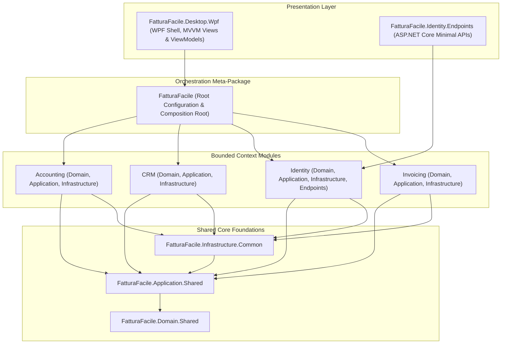

# FatturaFacile - System Architecture & Technical Specifications

This document outlines the architectural patterns, runtime mechanisms, and design decisions governing **FatturaFacile**.

---

## 1. Clean Architecture & Bounded Contexts

The solution enforces a strict inward dependency rule across its projects:



### Layer Responsibilities

1. **`FatturaFacile.Domain.Shared` & Module Domains (`*.Domain`)**
   - Core domain logic, rich entities with protected/private setters, business invariants, domain events, value objects (`Money`), and repository contracts.
   - **Zero external dependencies**: Depends only on the .NET 11 BCL. No references to EF Core, MediatR, or UI libraries.

2. **`FatturaFacile.Application.Shared` & Module Applications (`*.Application`)**
   - Use-case orchestration using the **CQRS** pattern with **MediatR**.
   - Contains DTOs, AutoMapper mapping profiles, FluentValidation validators, application interfaces, and pipeline behaviors (`ValidationBehavior`, `LoggingBehavior`).
   - Pure business logic depending exclusively on Domain projects.

3. **`FatturaFacile.Infrastructure.Common` & Module Infrastructures (`*.Infrastructure`)**
   - EF Core multi-provider persistence (SQLite, PostgreSQL, SQL Server), repository implementations, database configurations, and audit/tenant/outbox interceptors.
   - Depends on Application and Domain layers.

4. **`FatturaFacile.Desktop.Wpf` & Endpoint Layers**
   - WPF desktop client powered by Microsoft CommunityToolkit MVVM and Syncfusion WPF UI controls (`SfDataGrid`, `SfAccordion`, `SfNavigationDrawer`, `SfPdfViewer`).
   - Minimal API endpoints in `FatturaFacile.Identity.Endpoints` for ASP.NET Core integrations.

5. **`FatturaFacile` (Meta-Package)**
   - Unified composition root exposing `services.AddFatturaFacile(...)` to bootstrap all modules, persistence providers, localization, and identity pipelines.

---

## 2. Multi-Tenancy & Data Isolation

### Tenancy Enforcement
- Entities implementing `IMustHaveTenant` enforce mandatory `TenantId`.
- Global EF Core query filters isolate tenant data automatically:
  ```csharp
  builder.Entity<T>().HasQueryFilter(e => _tenantContext.IsTenantFilterIgnored || e.TenantId == _tenantContext.TenantId);
  ```
- `TenantSaveChangesInterceptor` guarantees tenant boundaries cannot be crossed during write operations.

---

## 3. Cross-Border Invoicing Architecture

- **Italy (SDI & FatturaPA 1.2.2)**:
  - Partita IVA / Codice Fiscale validation.
  - Split payment and withholding tax handling.
- **Switzerland (ISO 20022 QR-Bill)**:
  - 27-digit SCOR Modulo 10 reference generation.
  - Swiss 5-centimes (`0.05 CHF`) cash rounding calculated via `decimal.Round(unrounded * 20m) / 20m`.
  - QR-IBAN validation.

---

## 4. Security & Cryptographic Standards

- **Password Hashing**: Memory-hard Argon2id (`m=65536`, `t=4`, `p=2`) via `Argon2idPasswordHasher`.
- **PII Protection**: AES-256-GCM symmetric encryption for personal sensitive attributes (Swiss nLPD / FADP compliance) paired with SHA-256 blind indexing for query performance.
- **Token Handling**: Standardized JWT access tokens and cryptographically rotated refresh tokens.
