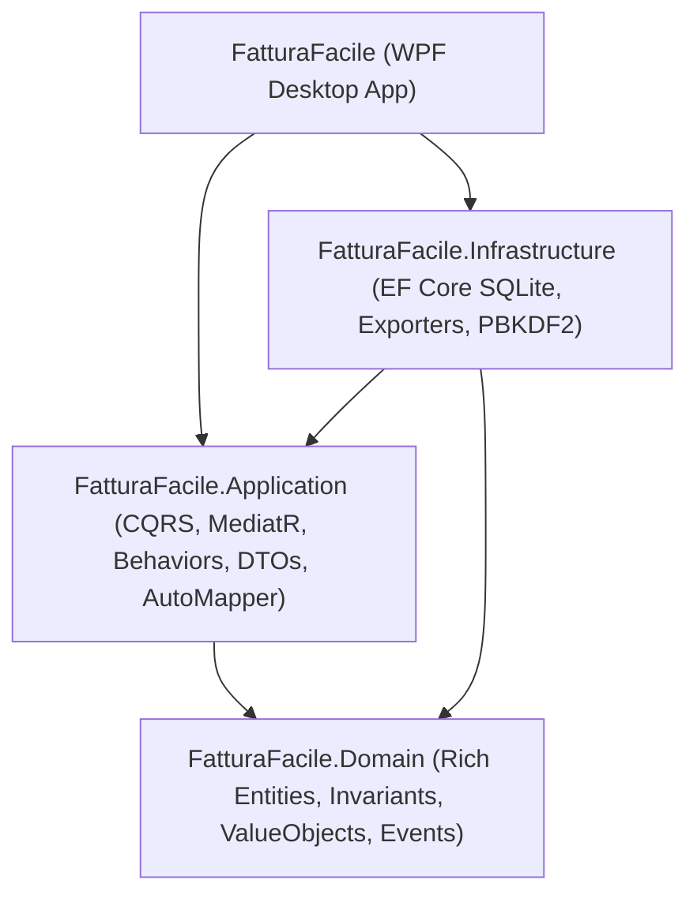

# FatturaFacile - Desktop ERP for Italian & Swiss Cross-Border Operations

[](https://dotnet.microsoft.com/)
[](#architecture-overview)
[](#)

**FatturaFacile** is a production-ready desktop Enterprise Resource Planning (ERP) suite engineered specifically for organizations conducting cross-border business between **Italy** and **Switzerland**. 

The client is built using **WPF** (.NET 11 Windows desktop) with modern MVVM (`CommunityToolkit.Mvvm`), backed by a 4-layer **Clean Architecture** with **Domain-Driven Design (DDD)**, **CQRS with MediatR**, **AutoMapper**, **Multi-Tenancy**, and dynamic **SQLite-persisted localization**.

---

## 🏛️ Architectural Overview

The solution adheres strictly to Clean Architecture layer separation:



- **`FatturaFacile.Domain`**: Pure domain core. Zero external library dependencies. Contains Rich Domain Entities for all 17 verticals, Value Objects (`Money` with 0.05 CHF Swiss cash rounding, `FiscalCode`, `VatNumber`, `QrIban`, `Address`), Aggregate Roots, Domain Events, and Repository interfaces.
- **`FatturaFacile.Application`**: CQRS orchestration layer using MediatR with strict pipeline behaviors (`LoggingBehavior` -> `TenantBehavior` -> `ValidationBehavior` -> `TransactionBehavior`), AutoMapper mapping profiles, and application service interfaces.
- **`FatturaFacile.Infrastructure`**: EF Core SQLite data access layer featuring multi-tenant global query filters, repository implementations, PBKDF2/SHA-512 password hashing, dynamic SQLite translation caching, and cross-border exporters (FatturaPA XML, Swiss QR-Bill SVG preview, ISO 20022 `pain.001`, `camt.053`).
- **`FatturaFacile`**: Native WPF presentation layer using `CommunityToolkit.Mvvm`, reactive dynamic localization markup extension `{loc:Translate KeyName}`, dynamic dark/light theme switching, and navigation shell with security gates.

---

## 🚀 Key Features Across 17 Business Modules

1. **Dashboard & Executive Overview**: Real-time KPI summaries, revenue broken down by EUR and CHF, and cross-border tax deadlines (Italian Esterometro/SDI & Swiss AFC/ESTV).
2. **CRM & Dual-Jurisdiction Address Book**: Unified management of Italian clients (Codice Fiscale, Partita IVA, Codice SDI, PEC) and Swiss clients (UID CHE-xxx.xxx.xxx, Cantonal codes, QR-IBAN).
3. **Sales & Cross-Border Invoicing**:
   - **Italy**: SDI FatturaPA 1.2.2 XML electronic invoice generation and lifecycle tracking.
   - **Switzerland**: Swiss QR-Bill (ISO 20022) with 27-digit SCOR Modulo 10 reference generation, 0.05 CHF cash rounding, and vector SVG visual preview.
4. **Purchasing & AP Cycle**: Purchase orders, incoming supplier invoice recording, and ISO 20022 `pain.001` credit transfer generation.
5. **Treasury & Banking**: ISO 20022 `camt.053` XML bank statement parsing, Italian CBI reconciliation, and multi-currency bank accounts.
6. **Inventory & Logistics**: Multi-warehouse stock tracking, Transport Documents (DDT / Waybill), customs CMR documentation, and lot/serial management.
7. **Service Tickets & Field Assistance**: Customer support tickets, SLA tracking, and technician work orders (*Rapportini*) with digital signature captures.
8. **Automotive & Tire Center (Gommista)**: Dual IT/CH license plate registration, seasonal tire hotel storage (Summer/Winter/All-Season), DOT code tracking, tread depth in mm, and statutory inspections (*Revisione* IT / *Collaudo MFK* CH).
9. **Vehicle Fleet & Car Rental**: Rental fleet tracking, bilingual rental agreements, damage inspection mapping, Swiss motorway vignette, and Telepass monitoring.
10. **Construction & Craftsmen (Cantieri)**: Construction site project ledger, Bill of Quantities (*Computo Metrico*), Swiss SIA / CRB / NPK compliance, Progress Billings (*SAL*), and Declarations of Conformity (DiCo / NIV).
11. **Professional Advisory (Legal & Tax Practices)**: Client matters (*Fascicoli*), AML/KYC checks, billable time ledger, and fee notes (*Parcelle*) with Italian *Casse Previdenziali*, *Ritenuta d'Acconto*, and Swiss fiduciary fees.
12. **Manufacturing & MRP**: Multi-level Bill of Materials (BOM), production work centers, and shop-floor order tracking.
13. **Retail & POS**: Electronic cash register integration (Italian Registratore Telematico RT) and Swiss POS payment receipts (SumUp, Worldline).
14. **Time Tracking & Labor Compliance**:
    - **Switzerland (ArG / OLL 1)**: Systemic recording vs simplified recording (*Vereinfachte Zeiterfassung*), opt-out waivers, 45h/50h statutory caps.
    - **Italy (D.Lgs. 66/2003 & LUL)**: 11-hour mandatory rest intervals, leave accruals (*Ferie*, *ROL*, Legge 104).
    - Medical certificates (IT INPS PUC / CH KTG/IGM) and Swiss military duty (APG/EO).
15. **Cross-Border Payroll & HR**: Employee master data supporting cross-border commuters (*Frontalieri IT-CH*), Swiss social insurance deductions (AVS/AI/LPP), cantonal withholding tax (*Imposta alla Fonte*), and Italian INPS/INAIL/F24 mapping.
16. **Fiscal & Statutory Accounting**: Double-entry journal entries supporting the Italian General Ledger and the Swiss SME Chart of Accounts (*KMU / PME Kontenrahmen*), periodic VAT settlements, and cross-border EU/CH transactions.
17. **Multi-Tenant Administration & Localization**: Multi-tenant database isolation, dynamic runtime language switching (Italian, German, French, English) with admin SQLite translation editor, and ECB / SNB exchange rate synchronization.

---

## 🛠️ Prerequisites & Setup

### Prerequisites
- Windows 10/11 x64 or ARM64.
- [.NET 9 or .NET 11 SDK](https://dotnet.microsoft.com/download) installed.
- SQLite3 (included automatically via `Microsoft.EntityFrameworkCore.Sqlite`).

### Default Admin Credentials
When launching the application for the first time, the local SQLite database (`fatturafacile.db`) is automatically seeded with default credentials:

| Tenant | Username | Password | Role |
| :--- | :--- | :--- | :--- |
| **TENANT-IT** (Milano Operations) | `admin` | `Admin123!` | SystemAdministrator |
| **TENANT-CH** (Lugano Operations) | `admin` | `Admin123!` | SystemAdministrator |

---

## 💻 Build & Test Instructions

Build the entire solution from PowerShell:

```powershell
# Restore and build the solution
dotnet build FatturaFacile.sln

# Run all unit tests
dotnet test FatturaFacile.sln
```

### Running the Desktop Client
To launch the WPF desktop interface:

```powershell
dotnet run --project src/FatturaFacile/FatturaFacile.csproj
```

---

## 🌐 Dynamic Localization (i18n)

FatturaFacile features a SQLite-backed dynamic localization engine. Texts are stored in the database table `AppTranslations` and can be customized at runtime without rebuilding the application:

- In XAML views:
  ```xml
  <TextBlock Text="{loc:Translate Shell_Nav_Clients, Default='Clients'}" />
  ```
- In ViewModels:
  ```csharp
  var translated = _localizationService.GetString("Common_Success", "Success");
  ```
- Supported languages:
  - `it` - Italiano (Default)
  - `de` - Deutsch
  - `fr` - Français
  - `en` - English

---

## 📁 Repository Structure

```
FatturaFacile/
├── src/
│   ├── FatturaFacile.Domain/            # Entities, Value Objects, Enums, Contracts
│   ├── FatturaFacile.Application/       # CQRS, MediatR Behaviors, DTOs, AutoMapper
│   ├── FatturaFacile.Infrastructure/    # EF Core SQLite, Exporters, Security
│   └── FatturaFacile/                   # WPF Presentation (Views, ViewModels, Themes)
├── tests/
│   └── FatturaFacile.Application.UnitTests/ # Unit & Integration tests
├── ARCHITECTURE.md                      # Comprehensive Architecture Documentation
├── CODING_STANDARDS.md                  # C# / WPF / Clean Architecture Standards
├── AI_RULES.md                          # Directives for AI Coding Agents
└── README.md
```
