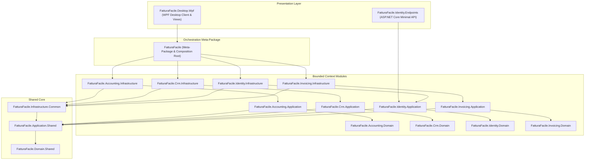

# FatturaFacile

[](#building--running-tests)
[](https://dotnet.microsoft.com/)
[](#architectural-overview)
[](#prerequisites--commercial-dependencies)

**FatturaFacile** is a production-ready enterprise modular ERP core engineered specifically for organizations conducting cross-border business between **Italy** and **Switzerland**.

Built on **.NET 11 (C# 13 preview)** with **Clean Architecture**, **Domain-Driven Design (DDD)**, **CQRS with MediatR**, **FluentValidation**, **AutoMapper**, **Multi-Tenancy**, and dynamic 4-language localization (EN, IT, DE, FR).

The solution offers both modular packable libraries (`FatturaFacile.*`), an orchestrating meta-package (`FatturaFacile`), and a desktop client powered by **WPF** and **Syncfusion Essential Studio for WPF**.

---

## 🏛️ Architectural Overview

The solution adheres strictly to Clean Architecture across shared foundations and bounded contexts:



### Solution Structure

```
FatturaFacile/
├── src/
│   ├── Common/
│   │   ├── FatturaFacile.Domain.Shared/           # Base entities, Money VO, tenancy & error contracts
│   │   ├── FatturaFacile.Application.Shared/      # CQRS interfaces, MediatR pipeline behaviors, localization
│   │   └── FatturaFacile.Infrastructure.Common/   # EF Core interceptors, outbox storage, multi-provider persistence
│   ├── Modules/
│   │   ├── Accounting/                            # General ledger, chart of accounts, journal entries
│   │   ├── Crm/                                   # Contacts, B2B/B2C profiles, cross-border identifiers
│   │   ├── Identity/                              # Users, tenants, Argon2id security, AES-256-GCM protection
│   │   └── Invoicing/                             # Invoices, Swiss QR-Bill, FatturaPA fiscal calculation
│   ├── Presentation/
│   │   └── FatturaFacile.Desktop.Wpf/             # WPF desktop client using MVVM Toolkit & Syncfusion
│   └── FatturaFacile/                             # Root composition package & fluent configuration API
├── tests/
│   ├── FatturaFacile.Domain.Tests/                # Invoice calculations & domain invariant tests
│   ├── FatturaFacile.Application.Tests/           # CQRS handler & localization tests
│   ├── FatturaFacile.Desktop.Tests/               # Desktop viewmodels & navigation tests
│   ├── FatturaFacile.Architecture.Tests/          # NetArchTest Clean Architecture enforcement rules
│   └── FatturaFacile.IntegrationTests/            # Multi-tenancy & end-to-end integration tests
└── docs/
    └── Architecture-Decisions.md                  # Comprehensive Architecture Decision Records (ADR)
```

---

## 🚀 Key Functional Capabilities

1. **Cross-Border Invoicing (Italy & Switzerland)**:
   - **Italy**: Compliant with SDI FatturaPA 1.2.2 requirements, Partita IVA and Codice Fiscale validation, split payment, and withholding tax rules.
   - **Switzerland**: ISO 20022 QR-Bill with 27-digit SCOR Modulo 10 reference generation, QR-IBAN validation, and standard Swiss cash rounding (`0.05 CHF`).

2. **General Ledger & Statutory Accounting**:
   - Double-entry bookkeeping verifying debit/credit equilibrium on every posted journal transaction.
   - Chart of Accounts accommodating both Italian civil ledger standards and the Swiss SME Chart of Accounts (*KMU / PME Kontenrahmen*).

3. **Dual-Jurisdiction CRM**:
   - Unified commercial contact management for Italian companies (PEC, Codice SDI, Partita IVA) and Swiss entities (UID `CHE-xxx.xxx.xxx`, Cantonal codes).

4. **Multi-Tenancy & Data Isolation**:
   - Compile-time enforcement via `IMustHaveTenant` and `ITenantEntity`.
   - Automatic tenancy filter application and mutation interceptor (`TenantSaveChangesInterceptor`).

5. **Security & Data Privacy (Swiss nLPD / EU GDPR)**:
   - Memory-hard **Argon2id** password hashing (`m=65536`, `t=4`, `p=2`).
   - PII data-at-rest encryption using **AES-256-GCM** with SHA-256 blind indexing for fast searchable lookups.
   - Brute-force account lockout protection and immutable security audit logs.

6. **Dynamic Multi-Language Support**:
   - 4 supported languages: English (`en`), Italian (`it`), German (`de`), French (`fr`).
   - Strong domain error decoupling through `IErrorLocalizer` and `DomainErrorDefinition`.

7. **Multi-Database Provider Persistence**:
   - First-class support for **SQLite**, **PostgreSQL** (`Npgsql`), and **Microsoft SQL Server**.
   - Transactional outbox pattern for reliable domain event persistence.

---

## 🛠️ Getting Started

### Prerequisites

- [.NET 11 SDK](https://dotnet.microsoft.com/)
- Visual Studio 2026 / Visual Studio Code / JetBrains Rider
- Windows 10/11 (for WPF client execution)

### Building the Solution

```bash
dotnet restore FatturaFacile.slnx
dotnet build FatturaFacile.slnx
```

### Running Tests

Execute the automated test suite across architecture, domain, application, and integration boundaries:

```bash
dotnet test tests/FatturaFacile.Architecture.Tests/FatturaFacile.Architecture.Tests.csproj
dotnet test tests/FatturaFacile.Domain.Tests/FatturaFacile.Domain.Tests.csproj
dotnet test tests/FatturaFacile.Application.Tests/FatturaFacile.Application.Tests.csproj
dotnet test tests/FatturaFacile.IntegrationTests/FatturaFacile.IntegrationTests.csproj
```

### Running the WPF Desktop Client

```bash
dotnet run --project src/Presentation/FatturaFacile.Desktop.Wpf/FatturaFacile.Desktop.Wpf.csproj
```

---

## 📦 Consuming the Library

Configure the complete ERP engine inside your ASP.NET Core API or generic host:

```csharp
using Microsoft.Extensions.DependencyInjection;
using FatturaFacile.Extensions;
using FatturaFacile.Infrastructure.Common.Configuration;

var builder = WebApplication.CreateBuilder(args);

builder.Services.AddFatturaFacile(options =>
{
    // Configure database provider
    options.UseDatabase(DatabaseProvider.Sqlite, "Data Source=FatturaFacile.db");

    // Configure multi-language localization
    options.ConfigureLocalization(
        supportedCultures: ["it", "de", "fr", "en"],
        defaultCulture: "it"
    );
});

var app = builder.Build();
app.Run();
```

---

## 📄 License & Commercial Dependencies

This project is licensed under the **MIT License**.

The desktop presentation client utilizes **Syncfusion Essential Studio for WPF**. Syncfusion NuGet packages are distributed via [nuget.org](https://www.nuget.org/), governed by the [Syncfusion End User License Agreement](https://www.syncfusion.com/eula). Eligible developers may use the [Syncfusion Community License](https://www.syncfusion.com/products/communitylicense).
