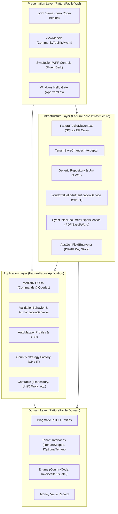
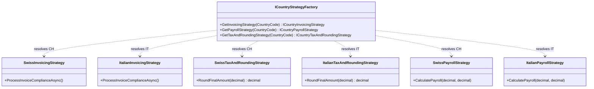

# FatturaFacile ERP Desktop ⚡

[-512BD4?logo=dotnet&logoColor=white)](https://dotnet.microsoft.com/)
[](https://learn.microsoft.com/dotnet/desktop/wpf/)
[-003B57?logo=sqlite&logoColor=white)](https://www.sqlite.org/)
[](#architecture--design)
[-red)](#zero-tactical-ddd-mandate)
[](#multi-tenancy--shared-defaults)
[](#security--biometric-authentication)
[-orange)](https://www.syncfusion.com/wpf-controls)

**FatturaFacile** is a high-performance, offline-first enterprise desktop ERP, invoicing, and accounting solution engineered for small-to-medium enterprises (SMEs), fiduciaries, and freelancers operating in **Switzerland (CH)** and **Italy (IT)**.

Built on **.NET 11**, **WPF**, and **SQLite**, FatturaFacile implements a strict **Clean Architecture** with a **ZERO Tactical DDD Mandate**, providing maintainability, rapid developer onboarding, zero object-relational impedance mismatch, row-level multi-tenancy, and hardware-grade security via **Windows Hello**.

---

## Table of Contents

- [Overview](#overview)
- [Architecture & Design](#architecture--design)
  - [Clean Architecture Layers](#clean-architecture-layers)
  - [ZERO Tactical DDD Mandate](#zero-tactical-ddd-mandate)
  - [Multi-Tenancy & Shared Defaults](#multi-tenancy--shared-defaults)
  - [Country Strategy Pattern (CH vs IT)](#country-strategy-pattern-ch-vs-it)
  - [Security & Biometric Authentication](#security--biometric-authentication)
- [Tech Stack & Prerequisites](#tech-stack--prerequisites)
  - [Prerequisites](#prerequisites)
  - [Technology Matrix](#technology-matrix)
  - [Key NuGet Packages](#key-nuget-packages)
- [Solution Structure](#solution-structure)
- [Getting Started & Configuration](#getting-started--configuration)
  - [Step-by-Step Setup](#step-by-step-setup)
  - [Configuration Settings](#configuration-settings)
  - [User Secrets (Development)](#user-secrets-development)
  - [Database Initialization & Migrations](#database-initialization--migrations)
- [Build, Run & Package](#build-run--package)
  - [Build Solution](#build-solution)
  - [Run Desktop Application](#run-desktop-application)
  - [Publish Binaries](#publish-binaries)
  - [Pack NuGet Packages](#pack-nuget-packages)
  - [Build Windows Installer](#build-windows-installer)
- [Testing & Code Quality](#testing--code-quality)
  - [Execute Tests](#execute-tests)
  - [Code Coverage (Coverlet)](#code-coverage-coverlet)
  - [Static Analysis & Quality Gates](#static-analysis--quality-gates)
- [License](#license)

---

## Overview

FatturaFacile is designed to operate completely offline with an embedded SQLite database, giving businesses sovereign control of their accounting and financial data while remaining fully compliant with regional fiscal standards in Switzerland and Italy:

- **Bilingual & Dual-Fiscal Localization:** Deep legal and operational support for Swiss franc (`CHF`) transactions with 5-centimes cash rounding, and Euro (`EUR`) transactions with standard 2-decimal rounding.
- **Swiss Electronic Invoicing & Standards:** Native Swiss QR-bill generator (SPC 0200) supporting QR-IBAN, Creditor Reference (QRR), ISO 11649 Structured Creditor Reference (SCOR), structured address formatting, and embedded SVG payment slips.
- **Italian Electronic Invoicing & SDI:** Generation and pre-transmission validation of Italian `FatturaPA v1.2` XML (FPR12/FPA12), including split payment, reverse charge, withholding tax (*ritenuta d'acconto*), virtual stamp duty (*bollo virtuale*), and LIPE quarterly VAT returns. Supports SDI transmission through folder queues or HTTP intermediaries.
- **Double-Entry General Ledger & Banking:** Full chart of accounts, double-entry journal transactions, fixed asset depreciation schedules, and automated camt.053 XML / camt.054 bank statement reconciliation.
- **Payroll & Working Time Engines:** Swiss payroll preview (AVS/AI/IPG, AD, LPP/BVG, and cantonal withholding tax tariffs) and Italian payroll preview (INPS, IRPEF, TFR, regional/municipal surcharges), paired with Swiss ArG / OLL 1 working time tracking and statutory retention enforcement.
- **Enterprise Offline Security:** Biometric authentication gate via Windows Hello (WinRT), PBKDF2 credential hashing, and AES-GCM database field encryption protected by the Windows Data Protection API (DPAPI).

---

## Architecture & Design

### Clean Architecture Layers

FatturaFacile adheres strictly to the concentric dependency inversion principle of Clean Architecture:



#### Dependency Flow Invariants
1. **`FatturaFacile.Domain`**: Core enterprise POCOs, enums, records, and tenant interfaces. Has **zero** external package dependencies.
2. **`FatturaFacile.Application`**: Business orchestration, MediatR CQRS handlers, FluentValidation pipeline behaviors, AutoMapper profiles, localized country strategies, and repository contracts. Depends **only** on `Domain`.
3. **`FatturaFacile.Infrastructure`**: EF Core SQLite data access, `TenantSaveChangesInterceptor`, DPAPI/AES-GCM field encryption, Windows Hello authentication (`UserConsentVerifier`), document export, and SDI transmitters. Implements interfaces defined in `Application`.
4. **`FatturaFacile.Wpf`**: Presentation shell hosting pure MVVM components, Syncfusion dark-themed controls (`FluentDark`), and DI bootstrapping via `Microsoft.Extensions.Hosting`.

---

### ZERO Tactical DDD Mandate

> [!IMPORTANT]
> **Tactical Domain-Driven Design (DDD) is strictly PROHIBITED across this codebase.**

To eliminate cognitive overhead, prevent object-relational mapping impedance mismatch, and ensure rapid developer ramp-up:
- **No Aggregate Roots:** Entities do not inherit from `AggregateRoot<TId>` and do not manage transactional boundaries.
- **No Domain Events or Outbox Pattern:** Entities never collect or dispatch `IDomainEvent` instances. There is no `outbox_messages` table or asynchronous polling dispatcher.
- **No Reflection-Based Value Objects:** Value objects with private constructors, reflection equality comparisons, or complex backing fields are banned. Composite values use clean C# records (e.g., `public sealed record Money(decimal Amount, string Currency)`).
- **Pragmatic Clean POCOs:** All domain entities are pure C# classes featuring public parameterless constructors and direct property accessors (`{ get; set; }`).
- **Separation of Concerns:** Business logic belongs exclusively in **MediatR Command/Query Handlers** and **Country Strategies** in the Application layer, keeping entities purely descriptive and easily serializable.

---

### Multi-Tenancy & Shared Defaults

FatturaFacile employs row-level multi-tenancy backed by EF Core global query filters and interceptors, ensuring complete tenant isolation within a single offline SQLite database:

| Pattern | Interface | `TenantId` Type | Behavior & Visibility |
| :--- | :--- | :--- | :--- |
| **Tenant-Isolated** | `ITenantScopedEntity` | `Guid` (non-nullable) | Strictly private to the active tenant. Filtered by `e.TenantId == _currentTenantService.TenantId`. Automatically populated upon creation. Used for `Invoice`, `GeneralLedgerEntry`, `HrEmployee`, `StockItem`. |
| **Shared Defaults** | `IOptionalTenantEntity` | `Guid?` (nullable) | Global records have `TenantId == null` and are accessible to **all** tenants (read-only). Filtered by `e.TenantId == null \|\| e.TenantId == _currentTenantService.TenantId`. Used for standard `VatCode`, base `ChartOfAccount`, `Contact`, `Product`. |

The `TenantSaveChangesInterceptor` enforces tenant boundaries before persisting to SQLite:
1. **Global Record Immutability:** Any attempt by a tenant to modify or delete a global record (`TenantId == null`) throws an `InvalidOperationException`.
2. **Auto-Tenant Assignment:** Newly added `ITenantScopedEntity` instances with `TenantId == Guid.Empty` are automatically assigned the active tenant ID from `ICurrentTenantService`.
3. **Automatic Auditing:** Entities implementing `IBaseEntity` automatically receive UTC timestamps for `CreatedAt` and `UpdatedAt`.

---

### Country Strategy Pattern (CH vs IT)

Fiscal and legal localization is resolved at runtime via the **Strategy Pattern** through `ICountryStrategyFactory`:



| Domain Feature | 🇨🇭 Switzerland (`CountryCode.CH`) | 🇮🇹 Italy (`CountryCode.IT`) |
| :--- | :--- | :--- |
| **Functional Currency** | `CHF` (Swiss Franc) | `EUR` (Euro) |
| **Rounding Algorithm** | **5-centimes (0.05) Swiss cash rounding** via `Round(amount * 20m) / 20m`. Delta tracked in `RoundingAmount`. | **Standard 2-decimal rounding (0.01)** via `Round(amount, 2, MidpointRounding.AwayFromZero)`. |
| **E-Invoicing Standard** | **Swiss QR-bill (SPC 0200)**: IBAN/QR-IBAN validation, QR reference (QRR) or ISO 11649 creditor reference (SCOR), structured addresses, Swiss cross QR code, SVG payment slip (`InvoiceQrBillData`). | **FatturaPA v1.2 XML (FPR12/FPA12)**: mandatory blocks, VAT summaries by rate/nature, split payment, reverse charge, ritenuta d'acconto, virtual stamp duty (`InvoiceSdiMetadata`). |
| **Payroll Deductions** | **Swiss payroll preview (2026)**: AVS/AI/IPG, AD with ceiling, LPP/BVG coordinated salary and age credits, LAINF NBU, IGM, withholding tax tariffs. | **Italian payroll preview (2026)**: INPS (incl. additional 1%), IRPEF 23/33/43% with art. 13 TUIR and tax-wedge deductions, regional/municipal surcharges, TFR accrual. |
| **Fiscal ID Fields** | UID / IDE (`CHE-xxx.xxx.xxx`), Swiss VAT register. | Partita IVA (11 digits), Codice Fiscale (16 alphanumeric characters). |

> [!WARNING]
> See [COMPLIANCE.md](COMPLIANCE.md) for detailed compliance disclosures. FatturaFacile provides offline payroll calculations and pre-transmission XML validation; it is not Swissdec-certified and does not transmit directly to the Italian SDI without an intermediary.

---

### Security & Biometric Authentication

- **Windows Hello & PIN:** At application startup (`App.xaml.cs`), `WindowsHelloAuthenticationService` queries `Windows.Security.Credentials.UI.UserConsentVerifier` to prompt for biometric verification (fingerprint, facial recognition) or Windows PIN.
- **Fail-Closed in Release:** If biometric hardware is unavailable or verification fails in Release builds, the application terminates immediately without exposing financial data. A developer fallback is available exclusively in Debug builds.
- **Field-Level Encryption:** Sensitive database fields (e.g., tax IDs, confidential payroll attributes) are encrypted using AES-GCM (`AesGcmFieldEncryptor`) with keys secured by the Windows Data Protection API (DPAPI) via `DpapiKeyStore`.
- **Password Hashing:** Local user credentials are protected using PBKDF2 (`Pbkdf2PasswordHasher`) with cryptographically secure salts.

---

## Tech Stack & Prerequisites

### Prerequisites

- **Operating System:** Windows 10 / Windows 11 (Build 19041.0 or higher required for WinRT Windows Hello and packaging support)
- **.NET SDK:** .NET 11 SDK (version `11.0.0` or higher, configured in [global.json](global.json) with `rollForward: latestFeature`)
- **IDE:** Visual Studio 2026 / Visual Studio 2022 (v17.12+), JetBrains Rider, or VS Code with C# Dev Kit

### Technology Matrix

| Component | Technology | Target Framework / Specification |
| :--- | :--- | :--- |
| **Runtime & SDK** | .NET 11 | `net11.0` (Core Libraries) / `net11.0-windows10.0.19041.0` (WPF & Infra) |
| **Language** | C# (Preview) | `<LangVersion>preview</LangVersion>`, `<EnablePreviewFeatures>true</EnablePreviewFeatures>` |
| **UI Framework** | WPF (Windows Presentation Foundation) | CommunityToolkit.Mvvm `8.4.2`, XAML, `Microsoft.Xaml.Behaviors.Wpf` `1.1.161` |
| **UI Controls & Theme** | Syncfusion WPF | Version `35.1.46` with `FluentDark` visual style |
| **Database & ORM** | SQLite & Entity Framework Core | `Microsoft.EntityFrameworkCore.Sqlite` `11.0.0` |
| **Application Host** | Generic Host & DI | `Microsoft.Extensions.Hosting` `11.0.0` |
| **Packaging & Installer** | Inno Setup & MSIX | `installer/FatturaFacile.iss` / `win-x64` self-contained publish |

### Key NuGet Packages

- **Architecture & Application:**
  - `MediatR` (15.0.0) — CQRS mediator pattern and pipeline behaviors
  - `FluentValidation` & `FluentValidation.DependencyInjectionExtensions` (12.2.0) — Pipeline request validation
  - `AutoMapper` (17.0.0) — Strict object-to-object DTO mapping
  - `CommunityToolkit.Mvvm` (8.4.2) — Source-generated MVVM observable properties and relay commands
- **Data & Documents:**
  - `Microsoft.EntityFrameworkCore` & `Microsoft.EntityFrameworkCore.Sqlite` (11.0.0) — ORM and SQLite driver
  - `Syncfusion.DocIO.Wpf`, `Syncfusion.DocToPDFConverter.Wpf`, `Syncfusion.Pdf.Wpf`, `Syncfusion.XlsIO.Wpf` (35.1.46) — Office and PDF document generation
  - `QRCoder` (1.8.1) — Swiss QR-bill standard QR code rendering
  - `SharpZipLib` (1.4.2) — Encrypted and compressed backup archives
- **Testing & Quality:**
  - `xunit` (2.9.3) & `xunit.runner.visualstudio` (4.0.1) — Test execution framework
  - `Moq` (4.21.0) — Mocking framework for unit tests
  - `Microsoft.EntityFrameworkCore.InMemory` (11.0.0) — In-memory provider for repository testing
  - `coverlet.collector` & `coverlet.msbuild` (10.1.1) — Cross-platform code coverage
  - `StyleCop.Analyzers` (1.3.180), `SonarAnalyzer.CSharp` (10.36.0.15337), `Meziantou.Analyzer` (3.0.339), `Roslynator.Analyzers`, `SecurityCodeScan.VS2019`, `AsyncFixer`, `IDisposableAnalyzers`

---

## Solution Structure

The solution definition is managed in [FatturaFacile.slnx](FatturaFacile.slnx):

```text
desktop/
├── FatturaFacile.slnx                   # Solution definition file
├── Directory.Build.props                # Global MSBuild properties, C# preview, analyzers
├── global.json                          # .NET 11 SDK version pin
├── LICENSE                              # MIT License
├── installer/
│   └── FatturaFacile.iss                # Inno Setup Windows installer script
├── src/
│   ├── FatturaFacile.Domain/            # Layer 1: Domain
│   │   ├── Common/                      # Base interfaces, Money record, tenant contracts
│   │   ├── Entities/                    # Pure POCO entities (Invoice, Contact, Tenant, etc.)
│   │   └── Enums/                       # Domain enumerations (CountryCode, InvoiceStatus, etc.)
│   │
│   ├── FatturaFacile.Application/       # Layer 2: Application
│   │   ├── Common/                      # Pipeline behaviors (Validation, Authorization), DTO mappings
│   │   ├── DTOs/                        # UI and report data transfer objects
│   │   ├── Features/                    # CQRS commands, queries, and master data record handlers
│   │   ├── Invoicing/                   # Swiss QR-bill and Italian FatturaPA calculators
│   │   ├── Payroll/                     # Swiss & Italian payroll engines and withholding tax stores
│   │   ├── Banking/                     # camt.053 / camt.054 statement parsers and reconciliation
│   │   ├── Strategies/                  # Localized Country Strategy Factory (CH / IT)
│   │   └── TimeTracking/                # Swiss ArG / OLL 1 working time engine and calendar
│   │
│   ├── FatturaFacile.Infrastructure/    # Layer 3: Infrastructure
│   │   ├── Persistence/                 # EF Core DbContext, Migrations, Migrator, Seeder, Interceptor
│   │   ├── Repositories/                # Generic Repository<T> and Unit of Work
│   │   ├── Security/                    # Windows Hello WinRT, DPAPI key store, AES-GCM encryptor
│   │   ├── Reporting/                   # Syncfusion document renderers and template store
│   │   └── Services/                    # Document export, QRCoder, SDI transmitters, backups
│   │
│   └── FatturaFacile.Wpf/               # Layer 4: Presentation
│       ├── App.xaml / App.xaml.cs       # Generic Host bootstrapper, Windows Hello gate, migrations
│       ├── appsettings.json             # Configuration file (copied to output)
│       ├── Localization/                # Resx translation files (Italian / English)
│       ├── ViewModels/                  # Pure MVVM ViewModels (CommunityToolkit.Mvvm)
│       └── Views/                       # WPF XAML views with zero code-behind
│
└── tests/
    └── FatturaFacile.UnitTests/         # Unit and integration test suite (98 tests)
```

### Project Responsibilities

| Project | Target Framework | Packable | Responsibility |
| :--- | :--- | :--- | :--- |
| **`FatturaFacile.Domain`** | `net11.0` | `true` | Enterprise core definitions: POCO entities, records (`Money`), enums, and tenant interfaces (`ITenantScopedEntity`, `IOptionalTenantEntity`). Zero external dependencies. |
| **`FatturaFacile.Application`** | `net11.0` | `true` | Business orchestration: MediatR CQRS handlers, FluentValidation pipelines, AutoMapper profiles, localized country strategies (CH/IT), banking reconciler, and time tracking. |
| **`FatturaFacile.Infrastructure`** | `net11.0-windows10.0.19041.0` | `true` | Persistence and OS integration: EF Core SQLite, `TenantSaveChangesInterceptor`, Windows Hello biometric authentication, AES-GCM field encryption, Syncfusion document export, and SDI transmitters. |
| **`FatturaFacile.Wpf`** | `net11.0-windows10.0.19041.0` | `false` | Presentation shell: Pure MVVM desktop UI, zero code-behind, Syncfusion dark-themed controls, localization, and generic host bootstrapping in `App.xaml.cs`. |
| **`FatturaFacile.UnitTests`** | `net11.0-windows10.0.19041.0` | `false` | Automated unit test suite verifying multi-tenancy isolation, country strategies, payroll calculations, QR-bills, FatturaPA XML, encryption, and AutoMapper configurations. |

---

## Getting Started & Configuration

### Step-by-Step Setup

1. **Clone the repository:**
   ```powershell
   git clone https://github.com/FatturaFacile/desktop.git
   cd desktop
   ```

2. **Restore NuGet dependencies:**
   ```powershell
   dotnet restore FatturaFacile.slnx
   ```

3. **Verify the installation:**
   ```powershell
   dotnet build FatturaFacile.slnx
   ```

---

### Configuration Settings

Configuration is loaded at startup via `Microsoft.Extensions.Hosting` from [src/FatturaFacile.Wpf/appsettings.json](src/FatturaFacile.Wpf/appsettings.json):

```json
{
  "AppConfig": {
    "configurationsFolder": "FatturaFacile.Wpf\\Configurations",
    "appPropertiesFileName": "AppProperties.json",
    "privacyStatement": "https://YourPrivacyUrlGoesHere/"
  },
  "Syncfusion": {
    "LicenseKey": ""
  }
}
```

#### Supported Configuration Keys & Environment Overrides

| Setting | Environment Variable | Default Value | Description |
| :--- | :--- | :--- | :--- |
| `ConnectionStrings:DefaultConnection` | `ConnectionStrings__DefaultConnection` | `%LocalAppData%\FatturaFacile\fattura-facile.sqlite` | SQLite database connection string. |
| `Syncfusion:LicenseKey` | `Syncfusion__LicenseKey` | `""` | Syncfusion commercial or community license key. |
| `Security:FieldEncryptionKeyPath` | `Security__FieldEncryptionKeyPath` | `%LocalAppData%\FatturaFacile\field-encryption.key` | Path to DPAPI-protected AES-GCM field encryption key. |
| `Sdi:Channel` | `Sdi__Channel` | `"Folder"` | SDI transmission mechanism (`"Folder"` or `"Http"`). |
| `Sdi:BaseUrl` | `Sdi__BaseUrl` | `null` | Base URL for the external HTTP SDI intermediary service. |
| `Sdi:ApiKey` | `Sdi__ApiKey` | `null` | API key for the external HTTP SDI intermediary service. |

---

### User Secrets (Development)

To configure secrets (such as the Syncfusion license key or test SDI credentials) without modifying source files, use .NET User Secrets:

```powershell
# Initialize user secrets for the WPF project
dotnet user-secrets init --project src/FatturaFacile.Wpf/FatturaFacile.Wpf.csproj

# Set the Syncfusion license key
dotnet user-secrets set "Syncfusion:LicenseKey" "YOUR_SYNCFUSION_LICENSE_KEY" --project src/FatturaFacile.Wpf/FatturaFacile.Wpf.csproj
```

---

### Database Initialization & Migrations

#### Automatic Migration & Seeding
At startup, `App.xaml.cs` automatically invokes `DatabaseSeeder.SeedAsync()`:
1. Applies pending EF Core migrations to the local SQLite database via `DatabaseMigrator.MigrateAsync()`.
2. Automatically creates a timestamped backup (`*.legacy-<timestamp>.bak`) if upgrading from an unversioned schema.
3. Automatically seeds initial tenants (`IT` and `CH`), default charts of accounts, standard VAT codes, and the administrator account if the database is newly initialized.

#### Manual Migrations with EF Core CLI Tools
The infrastructure layer provides a design-time factory (`DesignTimeDbContextFactory`), enabling standard `dotnet ef` commands:

```powershell
# Install the EF Core CLI tool globally (if not already installed)
dotnet tool install --global dotnet-ef

# Add a new migration
dotnet ef migrations add <MigrationName> `
  --project src/FatturaFacile.Infrastructure `
  --startup-project src/FatturaFacile.Wpf

# Apply migrations manually to the configured database
dotnet ef database update `
  --project src/FatturaFacile.Infrastructure `
  --startup-project src/FatturaFacile.Wpf
```

---

## Build, Run & Package

### Build Solution

```powershell
# Build entire solution in Debug configuration
dotnet build FatturaFacile.slnx

# Build entire solution in Release configuration (without re-restoring)
dotnet build FatturaFacile.slnx --configuration Release --no-restore
```

### Run Desktop Application

```powershell
# Launch the WPF application
dotnet run --project src/FatturaFacile.Wpf/FatturaFacile.Wpf.csproj
```

---

### Publish Binaries

#### Framework-Dependent Publish
```powershell
dotnet publish src/FatturaFacile.Wpf/FatturaFacile.Wpf.csproj -c Release
```

#### Self-Contained Single-File Publish (win-x64)
Used by the automated release pipeline to create standalone executables without requiring a pre-installed .NET runtime on the client machine:

```powershell
dotnet publish src/FatturaFacile.Wpf/FatturaFacile.Wpf.csproj `
  -c Release `
  -r win-x64 `
  --self-contained true `
  -p:PublishSingleFile=true `
  -p:PublishTrimmed=false `
  -p:DebugType=None `
  -p:DebugSymbols=false
```

---

### Pack NuGet Packages

Packages packable library projects (`FatturaFacile.Domain`, `FatturaFacile.Application`, and `FatturaFacile.Infrastructure`):

```powershell
# Create NuGet packages (.nupkg and .snupkg) in the artifacts/ folder
dotnet pack FatturaFacile.slnx -c Release -o artifacts
```

---

### Build Windows Installer

The repository includes an [Inno Setup](https://jrsoftware.org/isinfo.php) script located at [installer/FatturaFacile.iss](installer/FatturaFacile.iss):

```powershell
# 1. Publish the self-contained WPF application
dotnet publish src/FatturaFacile.Wpf/FatturaFacile.Wpf.csproj -c Release -r win-x64 --self-contained true

# 2. Compile the installer (requires Inno Setup command-line compiler ISCC)
$env:VERSION = "1.0.0"
ISCC installer\FatturaFacile.iss
```
The compiled setup wizard will be placed in `installer/Output/FatturaFacile-Setup.exe`.

---

## Testing & Code Quality

### Execute Tests

Execute all 98 unit and integration tests across the solution:

```powershell
# Run all tests
dotnet test

# Run tests in Release configuration with TRX test logger
dotnet test --configuration Release --no-build --logger trx
```

### Code Coverage (Coverlet)

Collect cross-platform code coverage in Cobertura XML format using Coverlet:

```powershell
dotnet test `
  --configuration Release `
  --no-build `
  --collect:"XPlat Code Coverage" `
  --results-directory TestResults `
  --logger trx
```
Coverage reports are output to `TestResults/**/coverage.cobertura.xml`.

---

### Static Analysis & Quality Gates

The solution enforces strict zero-tolerance code quality through [Directory.Build.props](Directory.Build.props) with `<TreatWarningsAsErrors>true</TreatWarningsAsErrors>` and `<AnalysisMode>All</AnalysisMode>`.

#### Code Formatting
```powershell
# Check formatting compliance (fails if unformatted code is detected)
dotnet format --verify-no-changes --verbosity diagnostic

# Automatically format all files in the solution
dotnet format
```

#### Enforced Analyzer Rules
- **StyleCop.Analyzers:** Enforces mandatory file copyright headers (`SA1633`), strictly one type per file (`SA1402`), and element order via [assets/stylecop.json](assets/stylecop.json).
- **XML Documentation:** Full documentation comments (`<summary>`, `<param>`, `<returns>`) are required on all public types and members (`GenerateDocumentationFile: true`).
- **SecurityCodeScan & SonarAnalyzer:** Static security analysis detecting SQL/path injection, cryptographic weaknesses, and resource leaks.
- **Meziantou.Analyzer & Roslynator:** Asynchronous patterns, thread safety, cancellation token forwarding, and performance optimizations.
- **EditorConfig:** Consistent indentation, line endings (CRLF on Windows), and syntax preferences specified in [.editorconfig](.editorconfig).

---

## License

This project is licensed under the terms of the [MIT License](LICENSE).

Copyright (c) 2026 FatturaFacile. All rights reserved.
