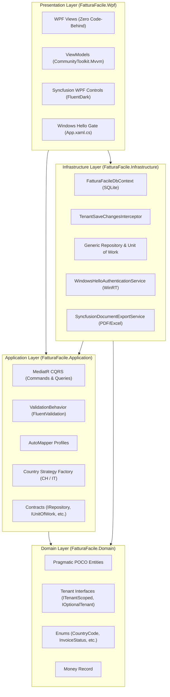
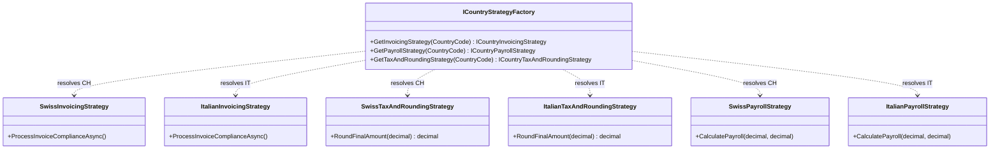

# FatturaFacile ERP Desktop ⚡

[-512BD4?logo=dotnet&logoColor=white)](https://dotnet.microsoft.com/)
[](https://learn.microsoft.com/dotnet/desktop/wpf/)
[-003B57?logo=sqlite&logoColor=white)](https://www.sqlite.org/)
[](#architectural-overview)
[-red)](#zero-ddd-mandate)
[](#multi-tenancy--shared-defaults)
[](#security--biometric-authentication)
[-orange)](https://www.syncfusion.com/wpf-controls)

**FatturaFacile** is a high-performance, offline-first enterprise desktop ERP and electronic invoicing solution engineered for small-to-medium enterprises (SMEs), fiduciaries, and freelancers operating in **Switzerland (CH)** and **Italy (IT)**. 

Built on **.NET 11**, **WPF**, and **SQLite**, FatturaFacile implements a strict **Clean Architecture** with a **ZERO Tactical DDD Mandate**, providing maximum maintainability, rapid junior developer onboarding, zero object-relational impedance mismatch, and hardware-grade security via **Windows Hello**.

---

## 🏛️ Architectural Overview

FatturaFacile adheres strictly to the four concentric layers of Clean Architecture:



### Dependency Inversion Rules
1. **`FatturaFacile.Domain`**: Core enterprise POCOs, enums, records, and interfaces. Has **zero** external package dependencies.
2. **`FatturaFacile.Application`**: Pure business orchestration, MediatR CQRS handlers, FluentValidation pipelines, AutoMapper profiles, and country-specific strategy interfaces. Depends only on `Domain`.
3. **`FatturaFacile.Infrastructure`**: EF Core SQLite data access, `TenantSaveChangesInterceptor`, hardware authentication (`WindowsHelloAuthenticationService`), and Syncfusion file export services. Implements interfaces defined in `Application`.
4. **`FatturaFacile.Wpf`**: Presentation shell hosting pure MVVM components, Syncfusion dark-themed controls (`FluentDark`), and DI bootstrapping via `Microsoft.Extensions.Hosting`.

---

## 🚫 ZERO DDD Mandate

> [!IMPORTANT]
> **Tactical Domain-Driven Design (DDD) is strictly PROHIBITED across this entire codebase.**

To guarantee high team velocity, eliminate cognitive overhead, and maintain frictionless developer workflows:
- **No Aggregate Roots:** Entities do not inherit from `AggregateRoot<TId>` and do not manage transactional boundaries.
- **No Domain Events or Outbox Pattern:** Entities never collect or raise `IDomainEvent` instances. There is no `outbox_messages` table or asynchronous event dispatcher.
- **No Reflection-Based Value Objects:** Value objects with private constructors, reflection equality comparisons, or complex backing fields are banned. The only allowed representation of a composite value is the pragmatic C# record (e.g., `Money(decimal Amount, string Currency)`).
- **Pragmatic Clean POCOs:** All domain entities are pure C# classes featuring public parameterless constructors and direct property accessors (`{ get; set; }`).
- **Separation of Concerns:** Business logic belongs exclusively in **MediatR Command/Query Handlers** and **Country Strategies** in the Application layer, keeping entities purely descriptive and easily serializable.

---

## 🏢 Multi-Tenancy & Shared Defaults

FatturaFacile employs row-level multi-tenancy backed by EF Core global query filters and interceptors, ensuring complete tenant isolation within a single offline SQLite database:

| Pattern | Interface | `TenantId` Type | Behavior & Visibility |
| :--- | :--- | :--- | :--- |
| **Tenant-Isolated** | `ITenantScopedEntity` | `Guid` (non-nullable) | Strictly private to the tenant. Filtered by `e.TenantId == _currentTenantService.TenantId`. Automatically populated upon creation. Used for `Invoice`, `GeneralLedgerEntry`, `HrEmployee`. |
| **Shared Defaults** | `IOptionalTenantEntity` | `Guid?` (nullable) | Global records have `TenantId == null` and are accessible to **all** tenants (read-only). Filtered by `e.TenantId == null \|\| e.TenantId == _currentTenantService.TenantId`. Used for standard `VatCode`, base `ChartOfAccount`, `Contact`, `Product`. |

### Security & Immutability Enforcement
The `TenantSaveChangesInterceptor` dynamically intercepts all changes before persisting to SQLite:
1. **Global Record Protection:** Any attempt by a tenant to update or delete a record where `TenantId == null` throws an `InvalidOperationException`.
2. **Auto-Tenant Assignment:** Newly added `ITenantScopedEntity` records with `TenantId == Guid.Empty` are automatically assigned the active tenant ID from `ICurrentTenantService`.
3. **Audit Tracking:** Entities implementing `IBaseEntity` automatically receive UTC timestamps for `CreatedAt` and `UpdatedAt`.

---

## 🌐 Country-Specific Strategy Pattern (CH vs IT)

FatturaFacile features deep fiscal, legal, and operational localization for Switzerland and Italy implemented via the **Strategy Pattern** (`ICountryStrategyFactory`):



### Country Localization Matrix

| Domain Feature | 🇨🇭 Switzerland (`CountryCode.CH`) | 🇮🇹 Italy (`CountryCode.IT`) |
| :--- | :--- | :--- |
| **Functional Currency** | `CHF` (Swiss Franc) | `EUR` (Euro) |
| **Rounding Algorithm** | **5-centimes (0.05) Swiss cash rounding** via `Round(amount * 20m) / 20m`. Delta tracked in `RoundingAmount`. | **Standard 2-decimal rounding (0.01)** via `Round(amount, 2, MidpointRounding.AwayFromZero)`. |
| **E-Invoicing Standard** | **ISO 20022 QR-Bill**: Generates QR-IBAN, 27-digit SCOR reference, and Swiss payment payload (`InvoiceQrBillData`). | **SDI / FatturaPA v1.2 XML**: Codice Destinatario (7 chars), PEC, Split Payment, Reverse Charge, Ritenuta d'acconto, Virtual Stamp Duty (`InvoiceSdiMetadata`). |
| **Payroll Deductions** | **Swissdec ELM Standard**: AVS/AI/APG (AHV 5.3%), AC (ALV 1.1%), BVG/LPP pension fund, UVG/LAA accident, KTG/AAN sickness, Quellensteuer withholding tax. | **INPS & Agenzia delle Entrate**: INPS worker social contributions (9.19%), IRPEF progressive tax brackets, regional/municipal surcharges, TFR severance accrual, CCNL guidelines. |
| **Fiscal ID Fields** | UID / IDE (`CHE-xxx.xxx.xxx`), Swiss VAT register. | Partita IVA (11 digits), Codice Fiscale (16 alphanumeric characters). |

---

## 🔒 Security & Biometric Authentication

FatturaFacile incorporates hardware-backed biometric security through native Windows API integrations:
- **Windows Hello & PIN:** At application startup (`App.xaml.cs`), `WindowsHelloAuthenticationService` queries `Windows.Security.Credentials.UI.UserConsentVerifier` to prompt for biometric verification (fingerprint, facial recognition) or Windows PIN.
- **Fail-Safe Startup Gate:** If authentication fails or is cancelled by the user, the application shuts down immediately without opening the main window or exposing financial records.
- **Developer Offline Fallback:** If biometric hardware is unavailable (e.g. CI environments or bare virtual machines), the service falls back gracefully to allow local testing and automated pipelines.

---

## 🎨 User Interface & Pure MVVM

The desktop client is crafted with **WPF** and styled with **Syncfusion WPF controls**:
- **Zero Code-Behind:** View code-behind files (`*.xaml.cs`) contain solely the parameterless constructor and `InitializeComponent()`. All UI events and user interactions bind directly to commands.
- **CommunityToolkit.Mvvm:** ViewModels leverage C# source generators (`[ObservableProperty]`, `[RelayCommand]`) to minimize boilerplate and prevent UI thread deadlocks.
- **FluentDark Aesthetic:** Styled via `Syncfusion.SfSkinManager.VisualStyle="FluentDark"` using high-contrast slate palettes (`#0D1117`, `#161B22`, `#30363D`).
- **High-Throughput Data Grids:** Data grids utilize `syncfusion:SfDataGrid` supporting real-time filtering, multi-column sorting, row resizing, and in-place document status visualizations.

---

## 📁 Repository Directory Structure

```text
c:\dev\fattura-facile\desktop\
├── .agy/                                # Antigravity CLI agent instructions
│   └── instructions.md                  # Machine-readable instructions for agy
├── .github/                             # GitHub automation and Copilot configurations
│   ├── workflows/                       # CI/CD pipelines (ci.yml, auto-merge.yml)
│   └── copilot-instructions.md          # Custom instructions for GitHub Copilot
├── assets/                              # Brand logos, icons, and analyzer assets
│   ├── img/                             # Application icons (logo.ico, logo.png)
│   └── stylecop.json                    # StyleCop analyzer rules configuration
├── docs/                                # Technical documentation and ADRs
│   └── Architecture-Decisions.md        # Architectural Decision Records (ADRs)
├── src/                                 # Production source code
│   ├── FatturaFacile.Domain/            # Layer 1: Entities (POCOs), Enums, Interfaces, Money
│   ├── FatturaFacile.Application/       # Layer 2: MediatR CQRS, FluentValidation, Strategies
│   ├── FatturaFacile.Infrastructure/    # Layer 3: SQLite EF Core, Repositories, Windows Hello
│   ├── FatturaFacile.Wpf/               # Layer 4: MVVM Views, ViewModels, Syncfusion UI
│   └── FatturaFacile.Wpf.Packaging/     # MSIX / Windows Store packaging project
├── tests/                               # Automated test suites
│   └── FatturaFacile.UnitTests/         # Multi-tenant, Strategy, and AutoMapper unit tests
├── AGENTS.md                            # Primary instructions for AI coding agents
├── ARCHITECTURE.md                      # Comprehensive Clean Architecture specification
├── CONTRIBUTING.md                      # Developer onboarding and contribution guidelines
├── Directory.Build.props                # Global MSBuild properties and strict analyzer rules
├── FatturaFacile.slnx                   # Modern XML-based solution definition
├── global.json                          # .NET 11 SDK pin
└── README.md                            # Root documentation (this file)
```

---

## 🚀 Getting Started & CLI Build

### Prerequisites
- Windows 10/11 (Build 19041+ for WinRT Windows Hello support)
- [.NET 11 SDK](https://dotnet.microsoft.com/) (`11.0.100-rc.3` or higher as defined in `global.json`)
- Visual Studio 2026 / Visual Studio 2022 (v17.12+) or JetBrains Rider with .NET 11 support
- Windows App SDK / Universal Windows App Development Tools (for `.wapproj` packaging)

### Build and Run from Terminal

1. **Clone the repository:**
   ```powershell
   git clone https://github.com/FatturaFacile/desktop.git
   cd desktop
   ```

2. **Restore NuGet dependencies:**
   ```powershell
   dotnet restore
   ```

3. **Verify code formatting:**
   ```powershell
   dotnet format --verify-no-changes --verbosity diagnostic
   ```

4. **Build the solution in Release mode:**
   ```powershell
   dotnet build --configuration Release --no-restore
   ```

5. **Execute all unit tests:**
   ```powershell
   dotnet test --configuration Release --no-build --logger trx
   ```

6. **Run the WPF desktop application:**
   ```powershell
   dotnet run --project src/FatturaFacile.Wpf/FatturaFacile.Wpf.csproj
   ```

---

## 📜 Quality Gates & Analyzers

The project enforces zero-tolerance code quality through `Directory.Build.props` with `<TreatWarningsAsErrors>true</TreatWarningsAsErrors>`. All PRs must comply with:
- **StyleCop.Analyzers:** Mandatory file copyright headers (`SA1633`), one type per file (`SA1402`), and ordering.
- **XML Documentation:** Full documentation comments (`<summary>`, `<param>`, `<returns>`) on all public members.
- **SecurityCodeScan & SonarAnalyzer:** Static security analysis for injection, cryptographic weaknesses, and resource leaks.
- **Meziantou.Analyzer & Roslynator:** Performance optimizations, asynchronous best practices, and code style.

---

## 📄 License
This project is licensed under the terms of the [MIT License](LICENSE). Copyright © Fattura Facile Contributors.
