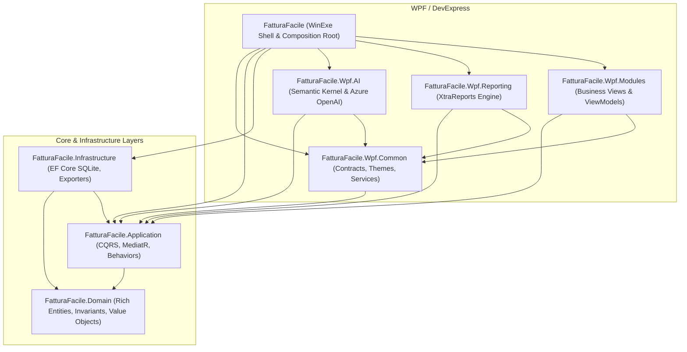

# Custom Agent Command: Update Docs and Comments (`agy`)

## Command Prompt Definition

```text
Role: Senior .NET 11 Software Architect & Technical Writer
Task: 
1. Scan the repository and inject/update comprehensive XML documentation comments (in English) for all public classes, interfaces, methods, properties, constructors, and view models.
2. Review and thoroughly update all Markdown (.md) documentation files in the workspace (including architecture diagrams, README, CQRS message catalogs, and dependency injection setups) to ensure complete alignment with the current codebase state.
```

---

# .NET 11 Modular DevExpress WPF Clean Architecture Blueprint

This document outlines the architectural blueprint, design patterns, folder structures, and implementation templates for **FatturaFacile**, an enterprise-grade modular WPF desktop solution built on **.NET 11** adhering to **SOLID**, **Clean Architecture**, and **DevExpress MVVM** principles.

---

## 1. Solution Architecture & Layers

The solution is divided into modular layers following the Dependency Inversion Principle: dependencies only point inwards.



### Directory & Project Breakdown

```
FatturaFacile/
├── src/
│   ├── FatturaFacile.Domain/            # Entities, Value Objects, Enums, Contracts
│   │   ├── Common/                      # BaseEntity, ValueObject, IAggregateRoot, ITenantEntity
│   │   ├── Entities/                    # 17 Business Module Entities (Client, Invoice, TireHotel, etc.)
│   │   ├── Enums/                       # Currency, PaymentMethod, DocumentType, VatRate
│   │   ├── Events/                      # IDomainEvent implementations
│   │   ├── Repositories/                # IClientRepository, IInvoiceRepository, etc.
│   │   └── ValueObjects/                # Money, FiscalCode, VatNumber, QrIban, Address
│   │
│   ├── FatturaFacile.Application/       # CQRS, MediatR, Behaviors, DTOs, AutoMapper
│   │   ├── Common/
│   │   │   ├── Behaviors/               # LoggingBehavior, TenantBehavior, ValidationBehavior, TransactionBehavior
│   │   │   ├── Exceptions/              # NotFoundException, ValidationException
│   │   │   └── Interfaces/              # IApplicationDbContext, ITenantProvider, ILocalizationService
│   │   ├── DTOs/                        # ClientDto, InvoiceDto, TireSetDto
│   │   ├── Features/                    # CQRS slices (Commands, Queries, Validators, Handlers)
│   │   │   ├── Clients/
│   │   │   └── Invoices/
│   │   ├── Mappings/                    # AutoMapper Profile classes
│   │   └── DependencyInjection.cs
│   │
│   ├── FatturaFacile.Infrastructure/    # Persistence, Exporters, Security
│   │   ├── CrossBorder/                 # FatturaPaExporter, SwissQrBillExporter, Pain001, Camt053
│   │   ├── Localization/                # SqliteLocalizationService
│   │   ├── Persistence/                 # FatturaFacileDbContext, DbInitializer, EntityConfigurations
│   │   ├── Repositories/                # EF Core repository implementations
│   │   ├── Security/                    # Pbkdf2PasswordHasher
│   │   └── DependencyInjection.cs
│   │
│   ├── FatturaFacile.Wpf.Common/        # Shared Presentation Infrastructure
│   │   ├── Behaviors/                   # GridColumnsBehavior, GridGroupingBehavior
│   │   ├── Contracts/                   # IDocumentModule, INavigationItem, IModuleInitializer, IViewModelFactory
│   │   ├── Converters/                  # DevExpress & WPF Value Converters
│   │   ├── Markup/                      # TranslateExtension
│   │   ├── Services/                    # UserStateService, LocalizationManager, ThemeManager
│   │   ├── Themes/                      # DarkTheme.xaml, LightTheme.xaml, Icons.xaml, Styles.xaml
│   │   └── ViewModels/                  # ViewModelBase, DocumentViewModelBase
│   │
│   ├── FatturaFacile.Wpf.Modules/       # Core Business Modules
│   │   ├── ViewModels/                  # ClientsViewModel, InvoicesViewModel, DashboardViewModel, etc.
│   │   ├── Views/                       # ClientsView, InvoicesView, DashboardView, etc.
│   │   └── BusinessModulesInitializer.cs
│   │
│   ├── FatturaFacile.Wpf.Reporting/     # Reporting Engine
│   │   ├── Controls/                    # BackstageDocumentPreview
│   │   ├── Modules/                     # ReportViewerModule, ReportDesignerModule
│   │   ├── Reports/                     # DevExpress XtraReports
│   │   └── ReportingModuleInitializer.cs
│   │
│   ├── FatturaFacile.Wpf.AI/            # AI Integration & Assistants
│   │   ├── Agents/                      # Semantic Kernel, WorkflowResponseProvider
│   │   ├── Modules/                     # DevExpress Chat UI, PromptToExpression, SmartPaste
│   │   ├── Tools/                       # AiGridTools, AiLayoutControlTools
│   │   └── AiModuleInitializer.cs
│   │
│   └── FatturaFacile/                   # WinExe Shell & Composition Root
│       ├── App.xaml / App.xaml.cs       # Generic Host Builder, Startup, Exception Handling
│       ├── MainWindow.xaml / .cs        # ThemedWindow, DockLayoutManager, Layout Persistence
│       └── ViewModels/MainViewModel.cs  # Shell ViewModel, Navigation & Document Management
│
└── tests/
    ├── FatturaFacile.Application.UnitTests/ # xUnit Unit Tests (140 tests)
    └── FatturaFacile.Tests/                 # NUnit WPF Integration Tests (BaseTestFixture)
```

---

## 2. Core Architectural Standards & Patterns

### A. Presentation Decoupling
* Presentation feature modules (`FatturaFacile.Wpf.Modules`, `FatturaFacile.Wpf.Reporting`, `FatturaFacile.Wpf.AI`) **never** reference `FatturaFacile.Infrastructure`.
* Feature modules interact with backend logic strictly through MediatR `ISender` / `IMediator` defined in `FatturaFacile.Application`.
* Only the composition root (`FatturaFacile` executable) wires together `Infrastructure` and presentation modules.

### B. Module Discovery via `IModuleInitializer`
UI projects implement `IModuleInitializer` to register views, view models, and services in dependency injection:
```csharp
namespace FatturaFacile.Wpf.Common;

public interface IModuleInitializer
{
    void Initialize(IServiceCollection services, IConfiguration configuration);
}
```

### C. CQRS & MediatR Pipeline Flow
* **Commands:** State-altering operations returning identifiers or results (e.g., `CreateClientCommand : IRequest<Guid>`).
* **Queries:** Side-effect-free data retrieval operations returning optimized DTOs (e.g., `GetClientsQuery : IRequest<IReadOnlyList<ClientDto>>`).
* **Pipeline Behaviors:** Transparent request interceptors executing in sequence:
  `LoggingBehavior` -> `TenantBehavior` -> `ValidationBehavior` -> `TransactionBehavior`.

---

## 3. Implementation Blueprints

### A. Domain Layer (Pure Domain & Value Objects)

```csharp
namespace FatturaFacile.Domain.ValueObjects;

using FatturaFacile.Domain.Common;
using FatturaFacile.Domain.Enums;
using FatturaFacile.Domain.Exceptions;

/// <summary>
/// Monetary value object combining an exact amount and an ISO currency.
/// </summary>
public sealed class Money : ValueObject
{
    /// <summary>
    /// Gets the monetary amount.
    /// </summary>
    public decimal Amount { get; }

    /// <summary>
    /// Gets the currency of the monetary amount.
    /// </summary>
    public Currency Currency { get; }

    /// <summary>
    /// Initializes a new instance of the <see cref="Money"/> class.
    /// </summary>
    public Money(decimal amount, Currency currency)
    {
        if (amount < 0)
            throw new DomainException("Amount cannot be negative.");

        Amount = amount;
        Currency = currency;
    }

    /// <summary>
    /// Applies Swiss statutory cash rounding to the nearest 0.05 CHF.
    /// </summary>
    public Money ToSwissCashRounding()
    {
        if (Currency != Currency.CHF)
            return this;

        var roundedAmount = Math.Round(Amount * 20m, MidpointRounding.AwayFromZero) / 20m;
        return new Money(roundedAmount, Currency);
    }

    protected override IEnumerable<object?> GetEqualityComponents()
    {
        yield return Amount;
        yield return Currency;
    }
}
```

---

### B. Application Layer (CQRS Command, Validator & Handler)

```csharp
namespace FatturaFacile.Application.Features.Clients.Commands;

using FluentValidation;
using MediatR;
using FatturaFacile.Application.Common.Interfaces;
using FatturaFacile.Domain.Entities;
using FatturaFacile.Domain.ValueObjects;

/// <summary>
/// Command to create a new commercial client within the active tenant.
/// </summary>
public sealed record CreateClientCommand(
    string CompanyName,
    string VatNumber,
    string? FiscalCode,
    string CountryCode) : IRequest<Guid>;

/// <summary>
/// Validator for <see cref="CreateClientCommand"/>.
/// </summary>
public sealed class CreateClientCommandValidator : AbstractValidator<CreateClientCommand>
{
    public CreateClientCommandValidator()
    {
        RuleFor(x => x.CompanyName).NotEmpty().MaximumLength(200);
        RuleFor(x => x.VatNumber).NotEmpty().MaximumLength(30);
        RuleFor(x => x.CountryCode).NotEmpty().Length(2);
    }
}

/// <summary>
/// Handler for <see cref="CreateClientCommand"/>.
/// </summary>
public sealed class CreateClientCommandHandler : IRequestHandler<CreateClientCommand, Guid>
{
    private readonly IApplicationDbContext _context;
    private readonly ITenantProvider _tenantProvider;

    public CreateClientCommandHandler(IApplicationDbContext context, ITenantProvider tenantProvider)
    {
        _context = context;
        _tenantProvider = tenantProvider;
    }

    /// <inheritdoc />
    public async Task<Guid> Handle(CreateClientCommand request, CancellationToken cancellationToken)
    {
        var client = new Client(
            Guid.NewGuid(),
            _tenantProvider.CurrentTenantId,
            request.CompanyName,
            new VatNumber(request.VatNumber, request.CountryCode));

        _context.Clients.Add(client);
        await _context.SaveChangesAsync(cancellationToken);

        return client.Id;
    }
}
```

---

### C. Presentation Layer (DevExpress MVVM ViewModel)

```csharp
namespace FatturaFacile.Wpf.Modules.ViewModels;

using DevExpress.Mvvm;
using FatturaFacile.Wpf.Common;
using FatturaFacile.Wpf.Common.Contracts;
using MediatR;

/// <summary>
/// ViewModel managing client directory display and operations.
/// </summary>
public sealed class ClientsViewModel : ViewModelBase, IDocumentModule
{
    private readonly ISender _sender;

    /// <summary>
    /// Gets the unique module identifier.
    /// </summary>
    public string ModuleId => "ClientsModule";

    /// <summary>
    /// Gets the document tab header caption.
    /// </summary>
    public string Caption => "Clients";

    /// <summary>
    /// Gets or sets whether this document module is active.
    /// </summary>
    public bool IsActive
    {
        get => GetProperty(() => IsActive);
        set => SetProperty(() => IsActive, value);
    }

    /// <summary>
    /// Gets the asynchronous command that refreshes client records.
    /// </summary>
    public IAsyncCommand RefreshCommand { get; }

    public ClientsViewModel(ISender sender)
    {
        _sender = sender;
        RefreshCommand = new AsyncCommand(ExecuteRefreshAsync);
    }

    private async Task ExecuteRefreshAsync()
    {
        // Issue CQRS query through MediatR
    }
}
```

---

### D. Testing Layer (xUnit Unit Tests & NUnit WPF Integration)

#### xUnit Unit Test:
```csharp
namespace FatturaFacile.Application.UnitTests.Features.Clients;

using FluentAssertions;
using Moq;
using FatturaFacile.Application.Common.Interfaces;
using FatturaFacile.Application.Features.Clients.Commands;
using Xunit;

public class CreateClientCommandHandlerTests
{
    [Fact]
    public async Task Handle_ValidCommand_PersistsClientAndReturnsId()
    {
        // Arrange
        var contextMock = new Mock<IApplicationDbContext>();
        var tenantMock = new Mock<ITenantProvider>();
        tenantMock.Setup(t => t.CurrentTenantId).Returns(Guid.NewGuid());

        var handler = new CreateClientCommandHandler(contextMock.Object, tenantMock.Object);
        var command = new CreateClientCommand("Acme SA", "CHE-123.456.789", null, "CH");

        // Act
        var result = await handler.Handle(command, CancellationToken.None);

        // Assert
        result.Should().NotBeEmpty();
    }
}
```

#### NUnit WPF Integration Test:
```csharp
namespace FatturaFacile.Tests;

using NUnit.Framework;
using FatturaFacile.Wpf.Common;

[TestFixture]
public class NavigationTests : BaseTestFixture
{
    [Test]
    public void DocumentGroup_SyncsActiveModule_WhenTabChanges()
    {
        // Validates DevExpress DockLayoutManager document activation
    }
}
```
