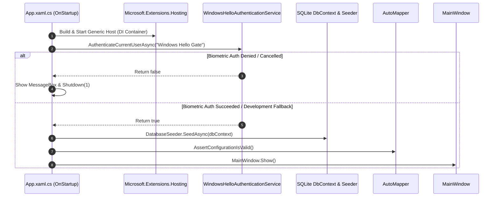

# FatturaFacile.Wpf

Presentation layer and enterprise desktop client for the FatturaFacile ERP solution.

## 🎯 Architectural Purpose & Rules
- **Layer Index:** Layer 4 (primary adapter layer).
- **Dependencies:** References `FatturaFacile.Application` and `FatturaFacile.Infrastructure`.
- **Primary Technologies:** WPF, XAML, CommunityToolkit.Mvvm, Syncfusion WPF Controls (`SfDataGrid`, `ChromelessWindow`, `FluentDark` theme), `Microsoft.Extensions.Hosting`.
- **Pure MVVM Mandate:** **ZERO CODE-BEHIND**. Code-behind files (`*.xaml.cs`) must contain **only** `InitializeComponent()`. All UI actions bind to commands in ViewModels.

---

## 📁 Project Structure

```text
FatturaFacile.Wpf/
├── App.xaml                            # Application resources and global styling
├── App.xaml.cs                         # Host bootstrapping, Windows Hello gate, DB seeding
├── appsettings.json                    # Connection strings and environment configuration
├── app.manifest                        # Windows execution level and DPI awareness
├── FatturaFacile.Wpf.csproj            # WPF project configuration (.NET 11 Windows)
├── Styles/                             # Custom XAML style dictionaries
│   ├── MetroWindow.xaml                # Modern window chrome styling
│   ├── TextBlock.xaml                  # Standard typography
│   └── _Thickness.xaml                 # Grid spacing and layout constants
├── ViewModels/                         # Pure MVVM ViewModels
│   ├── MainViewModel.cs                # Root shell, tenant switching, view navigation
│   ├── InvoicingViewModel.cs           # Invoice issuing, PDF/Excel export, data grid bindings
│   ├── AccountingViewModel.cs          # General ledger entries (Prima Nota), Chart of Accounts
│   ├── ContactsViewModel.cs            # Customer and supplier management
│   ├── ProductsViewModel.cs            # Catalog items and inventory overview
│   └── PayrollViewModel.cs             # Swiss / Italian payroll calculations & preview
└── Views/                              # UserControls and Windows
    ├── MainWindow.xaml                 # Root ChromelessWindow with dark Fluent theme
    ├── MainWindow.xaml.cs              # Code-behind (sets DataContext)
    ├── InvoicingView.xaml              # Invoices grid and action toolbar
    ├── InvoicingView.xaml.cs           # InitializeComponent() only
    ├── AccountingView.xaml             # Accounting journal view
    ├── AccountingView.xaml.cs          # InitializeComponent() only
    ├── ContactsView.xaml               # Contacts directory view
    ├── ContactsView.xaml.cs            # InitializeComponent() only
    ├── ProductsView.xaml               # Product catalog view
    ├── ProductsView.xaml.cs            # InitializeComponent() only
    ├── PayrollView.xaml                # Payroll calculation view
    └── PayrollView.xaml.cs             # InitializeComponent() only
```

---

## 🔐 Startup Flow & Security Gate (`App.xaml.cs`)

When the application launches, `App.xaml.cs` executes the following sequence:



---

## 🎨 Syncfusion WPF & Theme Integration

The UI is styled using Syncfusion's **FluentDark** theme:
```xaml
<syncfusion:ChromelessWindow
    ...
    sfSkinManager:SfSkinManager.VisualStyle="FluentDark"
    ...>
```

### Key Controls:
- **`syncfusion:ChromelessWindow`**: Modern borderless window with custom dark headers and integrated tenant switcher.
- **`syncfusion:SfDataGrid`**: Enterprise grid with column filtering, multi-sort, auto-sizing, and template columns for invoice status tags.

---

## 🛠️ View & ViewModel Implementation Rules

1. **ViewModels:**
   - Must inherit from `ObservableObject`.
   - Use `[ObservableProperty]` for automatic change notification fields.
   - Use `[RelayCommand]` for UI command binding.
   - Dispatch business requests via MediatR `ISender`.
2. **Views:**
   - Designed exclusively in XAML.
   - Bind controls to ViewModel properties using `{Binding ...}`.
   - Bind buttons to ViewModel commands using `Command="{Binding LoadInvoicesCommand}"`.
   - Never add click event handlers in code-behind!
