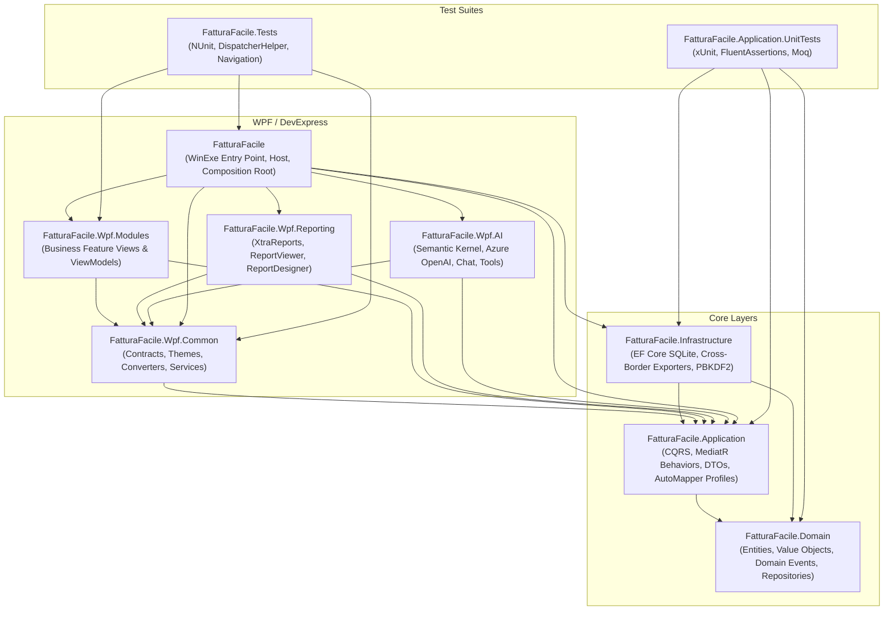
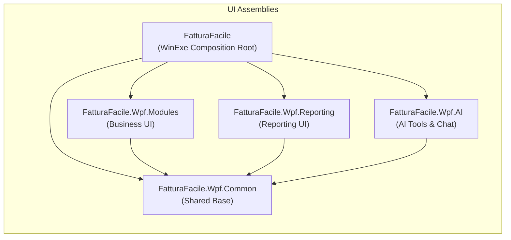

# FatturaFacile - Master Architecture, Documentation & Comments Reference

This reference document provides an exhaustive, production-grade guide to the architecture, codebase organization, domain models, CQRS handlers, AutoMapper configurations, UI architecture, and XML documentation standards for **FatturaFacile** (.NET 11 / C# 13).

---

## 1. Solution Architecture & Project Map

The solution is orchestrated via [FatturaFacile.slnx](file:///C:/dev/fattura-facile/desktop/FatturaFacile.slnx), cleanly segregating core domain logic, CQRS orchestration, persistence/exporters, and modular presentation components across 8 source projects and 2 test projects:



### Complete Project Catalogue

| Project | Target Framework | Output Type | Root Namespace | Primary Responsibilities |
| :--- | :--- | :--- | :--- | :--- |
| [FatturaFacile.Domain](file:///C:/dev/fattura-facile/desktop/src/FatturaFacile.Domain/FatturaFacile.Domain.csproj) | `net11.0` | Class Library | `FatturaFacile.Domain` | Pure domain core with **zero** external UI or ORM dependencies. Contains rich entities across 17 business verticals, immutable value objects, domain enums, repository interfaces, and domain events. |
| [FatturaFacile.Application](file:///C:/dev/fattura-facile/desktop/src/FatturaFacile.Application/FatturaFacile.Application.csproj) | `net11.0` | Class Library | `FatturaFacile.Application` | Business orchestration layer via **CQRS** with **MediatR**. Defines command/query handlers, validation pipeline behaviors, AutoMapper profiles, DTOs, and application interfaces. |
| [FatturaFacile.Infrastructure](file:///C:/dev/fattura-facile/desktop/src/FatturaFacile.Infrastructure/FatturaFacile.Infrastructure.csproj) | `net11.0` | Class Library | `FatturaFacile.Infrastructure` | External concern implementations: EF Core SQLite (`FatturaFacileDbContext`) with multi-tenant global query filters, repository implementations, PBKDF2/SHA-512 password hashing, dynamic SQLite translation caching, and cross-border exporters (FatturaPA XML, Swiss QR-Bill SVG, ISO 20022 `pain.001`, `camt.053`). |
| [FatturaFacile.Wpf.Common](file:///C:/dev/fattura-facile/desktop/src/FatturaFacile.Wpf.Common/FatturaFacile.Wpf.Common.csproj) | `net11.0-windows` | Class Library | `FatturaFacile.Wpf.Common` | Shared presentation infrastructure: core UI contracts (`IDocumentModule`, `INavigationItem`, `IModuleInitializer`), services (`IUserStateService`, `IViewModelFactory`, `LocalizationManager`), custom markup extensions (`TranslateExtension`), converters, behaviors, and DevExpress lightweight themes. |
| [FatturaFacile.Wpf.Modules](file:///C:/dev/fattura-facile/desktop/src/FatturaFacile.Wpf.Modules/FatturaFacile.Wpf.Modules.csproj) | `net11.0-windows` | Class Library | `FatturaFacile.Wpf.Modules` | Business feature modules: Views and ViewModels for Dashboard, Clients/CRM, Invoices/Sales, Tire Hotel (Automotive), Time Tracking, Localization Administration, and Authentication (`BusinessModulesInitializer`). |
| [FatturaFacile.Wpf.Reporting](file:///C:/dev/fattura-facile/desktop/src/FatturaFacile.Wpf.Reporting/FatturaFacile.Wpf.Reporting.csproj) | `net11.0-windows` | Class Library | `FatturaFacile.Wpf.Reporting` | DevExpress XtraReports engine integration: report viewer, report designer, print preview controls, mail merge templates, and cross-border document rendering (`ReportingModuleInitializer`). |
| [FatturaFacile.Wpf.AI](file:///C:/dev/fattura-facile/desktop/src/FatturaFacile.Wpf.AI/FatturaFacile.Wpf.AI.csproj) | `net11.0-windows` | Class Library | `FatturaFacile.Wpf.AI` | AI integrations: Microsoft.Extensions.AI, Azure OpenAI, Semantic Kernel, Vector Store, DevExpress Chat UI, Prompt-to-Expression converters, and smart assistant tooling (`AiModuleInitializer`). |
| [FatturaFacile](file:///C:/dev/fattura-facile/desktop/src/FatturaFacile/FatturaFacile.csproj) | `net11.0-windows` | WinExe | `FatturaFacile` | Composition root and desktop host shell. Configures generic host (`AppHost`), dependency injection, JIT profile optimization, dynamic theme initialization, DevExpress `ThemedWindow` with `DockLayoutManager`, and dock layout persistence (`DXSerializer`). |
| [FatturaFacile.Application.UnitTests](file:///C:/dev/fattura-facile/desktop/tests/FatturaFacile.Application.UnitTests/FatturaFacile.Application.UnitTests.csproj) | `net11.0` | Test | `FatturaFacile.Application.UnitTests` | xUnit test suite (140 tests) validating domain entities, value objects, CQRS handlers, MediatR pipeline behaviors, AutoMapper profiles, and infrastructure services. |
| [FatturaFacile.Tests](file:///C:/dev/fattura-facile/desktop/tests/FatturaFacile.Tests/FatturaFacile.Tests.csproj) | `net11.0-windows` | Test | `FatturaFacile.Tests` | NUnit integration and functional test suite validating WPF navigation, STA dispatcher queue pumping, module initialization, and dock layout synchronization. |

---

## 2. Real Domain Entities Across All 17 Business Verticals

All entities reside in `src/FatturaFacile.Domain/Entities/` partitioned into namespace folders matching their respective business domain:

| Domain Vertical | Folder / Namespace | Real Domain Entities |
| :--- | :--- | :--- |
| **Accounting** | `Entities.Accounting` | `GeneralLedgerAccount`, `GeneralLedgerEntry`, `GeneralLedgerLine`, `VatSettlementPeriod` |
| **Administration** | `Entities.Administration` | `AppTranslation`, `Branch`, `ExchangeRate`, `Tenant`, `User` |
| **Advisory** | `Entities.Advisory` | `BillableTimeEntry`, `ClientMatter`, `ProfessionalFeeNote` |
| **Automotive** | `Entities.Automotive` | `CustomerVehicle`, `StatutoryInspectionRecord`, `TireHotelRecord` |
| **Construction** | `Entities.Construction` | `BillOfQuantitiesItem`, `ConstructionSite`, `DeclarationOfConformity`, `ProgressBillingSal` |
| **CRM** | `Entities.Crm` | `Client`, `Contact`, `Supplier` |
| **Dashboard** | `Entities.Dashboard` | `ExecutiveKpiSummary`, `TaxDeadlineAlert` |
| **Fleet & Rental** | `Entities.FleetRental` | `DamageAppraisal`, `RentalBooking`, `RentalVehicle` |
| **Inventory & Logistics** | `Entities.Inventory` | `ItemCatalog`, `StockMovement`, `TransportDocument`, `Warehouse` |
| **Manufacturing & MRP** | `Entities.Manufacturing` | `BillOfMaterials`, `BomLine`, `ProductionOrder`, `WorkCenter` |
| **Payroll & HR** | `Entities.PayrollHr` | `Employee`, `PayrollSlipSummary` |
| **Purchasing & AP** | `Entities.Purchasing` | `Iso20022PaymentInstruction`, `PassiveInvoice`, `PurchaseOrder` |
| **Retail & POS** | `Entities.RetailPos` | `PosTerminalSession`, `RetailReceipt` |
| **Sales & Invoicing** | `Entities.Sales` | `InvoiceLine`, `ItalianElectronicInvoice`, `PriceList`, `Quote`, `SalesOrder`, `SwissQrBill` |
| **Service Tickets** | `Entities.ServiceTickets`| `SupportTicket`, `TechnicianWorkOrder` |
| **Time Tracking** | `Entities.TimeTracking` | `AbsenceRecord`, `TimeEntry` |
| **Treasury & Banking** | `Entities.Treasury` | `BankStatement`, `BankTransactionLine` |

### Value Objects (`FatturaFacile.Domain.ValueObjects`)
- **`Money`**: Immutable amount and currency (`Currency.EUR` or `Currency.CHF`). Prevents cross-currency math. Implements `ToSwissCashRounding()` enforcing the statutory Swiss 0.05 CHF cash rounding rule.
- **`FiscalCode`**: Validates Italian 16-character alphanumeric Codice Fiscale or 11-digit numeric formats.
- **`VatNumber`**: Validates Italian 11-digit Partita IVA (`ITxxxxxxxxxxx`) and Swiss Business Identification Numbers (`CHE-xxx.xxx.xxx MWST/TVA/IVA`).
- **`QrIban`**: Validates Swiss/Liechtenstein QR-IBANs with Institute Identification (IID) falling strictly in the range **30000 to 31999**.
- **`Address`**: Immutable postal address encapsulating street, postal code, city, province/canton, and country code.

### Repository Interfaces (`FatturaFacile.Domain.Repositories`)
- `IRepository<T>` (generic base with LINQ queries and specification support)
- `IUnitOfWork` (atomic transaction coordination)
- `IClientRepository`, `IItalianInvoiceRepository`, `ISwissQrBillRepository`, `ITenantRepository`, `ITimeEntryRepository`, `ITireRecordRepository`, `ITranslationRepository`, `IUserRepository`

---

## 3. Real CQRS Commands, Queries & MediatR Handlers

All CQRS features reside in `src/FatturaFacile.Application/Features/`:

| Feature Area | Command / Query | Handler | Validator |
| :--- | :--- | :--- | :--- |
| **Administration** | `GetTenantsQuery` | `GetTenantsQueryHandler` | - |
| | `LoginCommand` | `LoginCommandHandler` | `LoginCommandValidator` |
| | `SwitchTenantCommand` | `SwitchTenantCommandHandler` | - |
| **Automotive** | `CreateTireRecordCommand` | `CreateTireRecordCommandHandler` | - |
| | `GetTireRecordsQuery` | `GetTireRecordsQueryHandler` | - |
| **Clients** | `CreateClientCommand` | `CreateClientCommandHandler` | `CreateClientCommandValidator` |
| | `GetClientsQuery` | `GetClientsQueryHandler` | - |
| **Dashboard** | `GetDashboardOverviewQuery` | `GetDashboardOverviewQueryHandler` | - |
| **Invoices** | `CreateItalianInvoiceCommand` | `CreateItalianInvoiceCommandHandler` | - |
| | `CreateSwissQrBillCommand` | `CreateSwissQrBillCommandHandler` | - |
| | `GetInvoicesOverviewQuery` | `GetInvoicesOverviewQueryHandler` | - |
| **Localization** | `GetTranslationsQuery` | `GetTranslationsQueryHandler` | - |
| | `UpdateTranslationCommand` | `UpdateTranslationCommandHandler` | - |
| **TimeTracking** | `ClockInCommand` | `ClockInCommandHandler` | - |
| | `ClockOutCommand` | `ClockOutCommandHandler` | - |
| | `GetTimeEntriesQuery` | `GetTimeEntriesQueryHandler` | - |

### MediatR Pipeline Behaviors (`FatturaFacile.Application.Common.Behaviors`)
Request pipelines are registered in strict execution order:
1. **`LoggingBehavior<TRequest, TResponse>`**: Stopwatch measurement and structured logging; flags queries taking >500ms.
2. **`TenantBehavior<TRequest, TResponse>`**: Asserts that `ITenantProvider.CurrentTenantId` is resolved before executing tenant-scoped requests.
3. **`ValidationBehavior<TRequest, TResponse>`**: Scans registered FluentValidation validators and throws a structured `ValidationException` on failure.
4. **`TransactionBehavior<TRequest, TResponse>`**: Wraps commands in atomic SQLite database transactions with rollback on uncaught exceptions.

---

## 4. Real AutoMapper Profiles & DTOs

### AutoMapper Profiles (`src/FatturaFacile.Application/Mappings/`)
- **`AdministrationProfile`**: Maps `Tenant` -> `TenantDto`, `User` -> `UserDto`, `AppTranslation` -> `AppTranslationDto`.
- **`ClientProfile`**: Maps `Client` -> `ClientDto` (flattens `VatNumber`, `FiscalCode`, `Address`).
- **`InvoiceProfile`**: Maps `ItalianElectronicInvoice` -> `ItalianInvoiceDto`, `SwissQrBill` -> `SwissQrBillDto`, `InvoiceLine` -> `InvoiceLineDto`.
- **`SupplierProfile`**: Maps `Supplier` -> `SupplierDto`.
- **`TimeSheetProfile`**: Maps `TimeEntry` -> `TimeEntryDto`, `AbsenceRecord` -> `AbsenceDto`.
- **`TireRecordProfile`**: Maps `TireHotelRecord` -> `TireHotelDto`, `CustomerVehicle` -> `CustomerVehicleDto`.
- **`TransportDocumentProfile`**: Maps `TransportDocument` -> `TransportDocumentDto`, `PurchaseOrder` -> `PurchaseOrderDto`.

### Application DTOs (`src/FatturaFacile.Application/DTOs/`)
`AbsenceDto`, `AppTranslationDto`, `ClientDto`, `CustomerVehicleDto`, `DashboardKpiDto`, `InvoiceLineDto`, `ItalianInvoiceDto`, `PurchaseOrderDto`, `SupplierDto`, `SwissQrBillDto`, `TenantDto`, `TimeEntryDto`, `TireHotelDto`, `TransportDocumentDto`, `UserDto`.

---

## 5. UI Architecture & Presentation Modules

### Modular Presentation Structure



### Presentation Decoupling Rules
- **No Direct Infrastructure References**: Feature modules (`FatturaFacile.Wpf.Modules`, `FatturaFacile.Wpf.Reporting`, `FatturaFacile.Wpf.AI`) depend **only** on `FatturaFacile.Application` and `FatturaFacile.Wpf.Common`.
- **Composition Root**: Only the shell executable ([FatturaFacile](file:///C:/dev/fattura-facile/desktop/src/FatturaFacile/FatturaFacile.csproj)) references `FatturaFacile.Infrastructure` to wire the EF Core DbContext and services into the generic host container.

### Module Discovery (`IModuleInitializer`)
Each UI assembly declares an `IModuleInitializer`:
- `CommonModuleInitializer` (registers `IUserStateService`, `IViewModelFactory`)
- `BusinessModulesInitializer` (registers business Views and ViewModels)
- `ReportingModuleInitializer` (registers XtraReports Viewers, Designers, and ViewModels)
- `AiModuleInitializer` (registers AI ViewModels, tools, and background services)

### DevExpress MVVM & DockLayoutManager
- **Base ViewModels**: Inherit from `ViewModelBase` or `DocumentViewModelBase`.
- **Document Contract**: Implement `IDocumentModule` (`Caption`, `IsActive`) to participate in `DocumentGroup` tab synchronization.
- **Layout Serialization**: DevExpress `DXSerializer` manages workspace docking configurations, persisted to `%LocalAppData%\FatturaFacile\userstate.json` via `IUserStateService`.
- **Type Disambiguation**: Use `System.Windows.Controls.UserControl` and `System.Windows.Application.Current` to avoid collisions with Windows Forms types.

---

## 6. XML Documentation Rules & Standards

In accordance with [Directory.Build.props](file:///C:/dev/fattura-facile/desktop/Directory.Build.props), `<GenerateDocumentationFile>true</GenerateDocumentationFile>` is enabled across the solution. Every public symbol has been inspected and updated with complete English XML docstrings.

### Documentation Requirements
1. **Language**: English exclusively for all docstrings.
2. **Scope**: Every public `class`, `interface`, `record`, `struct`, `enum`, method, property, constructor, and event.
3. **Tags**:
   - `<summary>`: High-level overview explaining the purpose and business intent.
   - `<param name="...">`: Description of each parameter, including valid ranges or constraints.
   - `<returns>`: Description of returned value or task completion semantics.
   - `<exception cref="...">`: Document all expected domain or validation exceptions.

---

## 7. Build, Verification, & Test Execution

### Build Command
```powershell
# Restore and build all 10 projects
dotnet build FatturaFacile.slnx
```

### Running All Tests
```powershell
# Execute the complete test suite (143 total tests)
dotnet test FatturaFacile.slnx
```

### Running Targeted Test Projects
```powershell
# Application & Domain unit tests (xUnit)
dotnet test tests/FatturaFacile.Application.UnitTests/FatturaFacile.Application.UnitTests.csproj

# WPF Navigation & Docking functional tests (NUnit)
dotnet test tests/FatturaFacile.Tests/FatturaFacile.Tests.csproj
```
